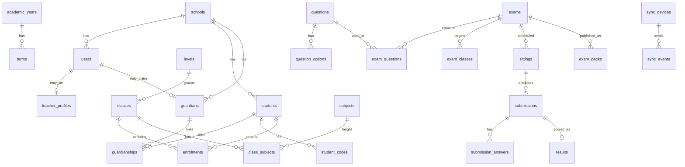

# CBT Platform — 02 Data Model

**Version 1.0** · Companion to `CBT-Technical-Design.md`, `CBT-01-Product-Requirements.md` (PRD), `CBT-03-API-and-Sync-Specification.md`.

This document defines every table in the two databases: **PostgreSQL (cloud)** and **SQLite (school exam server)**. Business rules (`BR-xx`) refer to the PRD.

---

## 1. Conventions

| Topic | Rule |
|---|---|
| IDs | UUIDv7 stored as `text` (Postgres `uuid` is also acceptable; pick one and keep it). Time-ordered so they index well and can be generated offline by the school server without collisions. |
| Timestamps | UTC, `timestamptz` in Postgres, ISO-8601 text (`2026-10-11T09:30:00.000Z`) in SQLite. Display in `Africa/Lagos` in the UI only. |
| Money | Integer **kobo**. Never floats. |
| Soft delete | Business records use `status` or `deleted_at`. Audit and answer data are never deleted by the app. |
| Multi-school | Every school-owned table has `school_id`. All queries are scoped by it. Optional Postgres Row-Level Security (RLS) on `school_id` as a second line of defence. |
| Names | `snake_case`, singular nouns for rows, plural table names. |
| Enums | Text columns with `CHECK` constraints (easier to evolve than Postgres enum types). |
| Ownership | Cloud owns: setup, questions, exams, parents, review and release. School server owns: sittings, sessions, answers, raw scores. (Technical Design §6.3.) |

---

## 2. Cloud database (PostgreSQL)

### 2.1 Entity overview



### 2.2 Tenancy and identity

```sql
CREATE TABLE schools (
  id            text PRIMARY KEY,
  code          text NOT NULL UNIQUE CHECK (code ~ '^[A-Z0-9]{3,6}$'),  -- used in student codes
  name          text NOT NULL,
  address       text,
  state         text,                                   -- Nigerian state
  contact_email citext,
  logo_asset_id text,
  timezone      text NOT NULL DEFAULT 'Africa/Lagos',
  grade_scale_id text,
  plan          text,                                   -- licence plan name
  student_cap   int,                                    -- NULL = no cap
  licence_expires_on date,                              -- after this the school is read-only (US-1.3)
  settings      jsonb NOT NULL DEFAULT '{}'::jsonb,     -- keys listed in the API spec, section 11.3
  status        text NOT NULL DEFAULT 'active' CHECK (status IN ('active','suspended')),
  created_at    timestamptz NOT NULL DEFAULT now()
);

CREATE TABLE users (
  id             text PRIMARY KEY,
  school_id      text REFERENCES schools(id),         -- NULL only for platform_owner
  role           text NOT NULL CHECK (role IN ('platform_owner','school_admin','teacher','parent','bursar')),
  full_name      text NOT NULL,
  email          citext,
  phone_e164     text,                                  -- normalised, e.g. +2348012345678
  password_hash  text,                                  -- argon2id; NULL until claimed
  status         text NOT NULL DEFAULT 'invited'
                   CHECK (status IN ('invited','active','suspended','deactivated')),
  totp_secret_enc bytea,                                -- required for platform_owner / first admin
  failed_logins  int NOT NULL DEFAULT 0,
  locked_until   timestamptz,
  last_login_at  timestamptz,
  created_at     timestamptz NOT NULL DEFAULT now(),
  CHECK (email IS NOT NULL OR phone_e164 IS NOT NULL)
);
CREATE UNIQUE INDEX users_school_email ON users(school_id, email) WHERE email IS NOT NULL;
CREATE UNIQUE INDEX users_school_phone ON users(school_id, phone_e164) WHERE phone_e164 IS NOT NULL;

CREATE TABLE teacher_profiles (
  user_id     text PRIMARY KEY REFERENCES users(id),
  staff_no    text,
  title       text
);

CREATE TABLE sessions (                       -- web login sessions (HttpOnly cookie)
  id          text PRIMARY KEY,               -- hash of cookie token
  user_id     text NOT NULL REFERENCES users(id),
  created_at  timestamptz NOT NULL DEFAULT now(),
  expires_at  timestamptz NOT NULL,
  last_seen_at timestamptz,
  ip          inet,
  user_agent  text
);

CREATE TABLE invitations (
  id            text PRIMARY KEY,
  school_id     text NOT NULL REFERENCES schools(id),
  kind          text NOT NULL CHECK (kind IN ('staff','guardian','password_reset')),
  user_id       text REFERENCES users(id),        -- staff: the pre-created user
  guardian_id   text REFERENCES guardians(id),    -- guardian: the record being claimed
  token_hash    text NOT NULL UNIQUE,             -- SHA-256 of the single-use token
  channel       text NOT NULL CHECK (channel IN ('email','sms','whatsapp','printed','manual_link')),
  sent_to       text,
  status        text NOT NULL DEFAULT 'pending'
                  CHECK (status IN ('pending','sent','used','expired','revoked','failed')),
  expires_at    timestamptz NOT NULL,             -- +7d staff, +14d guardians
  created_by    text REFERENCES users(id),
  used_at       timestamptz,
  created_at    timestamptz NOT NULL DEFAULT now()
);

CREATE TABLE otp_challenges (
  id            text PRIMARY KEY,
  invitation_id text REFERENCES invitations(id),
  user_id       text REFERENCES users(id),
  purpose       text NOT NULL CHECK (purpose IN ('activate','reset','verify_contact')),
  sent_to       text NOT NULL,
  code_hash     text NOT NULL,
  attempts      int NOT NULL DEFAULT 0,           -- max 5
  expires_at    timestamptz NOT NULL,             -- 10 minutes
  consumed_at   timestamptz,
  created_at    timestamptz NOT NULL DEFAULT now()
);
```

### 2.3 People: students, guardians, codes

```sql
CREATE TABLE students (
  id             text PRIMARY KEY,
  school_id      text NOT NULL REFERENCES schools(id),
  admission_no   text NOT NULL,
  first_name     text NOT NULL,
  last_name      text NOT NULL,
  other_names    text,
  gender         text CHECK (gender IN ('M','F')),
  date_of_birth  date,
  photo_asset_id text,
  status         text NOT NULL DEFAULT 'active' CHECK (status IN ('active','graduated','withdrawn')),
  created_at     timestamptz NOT NULL DEFAULT now(),
  UNIQUE (school_id, admission_no)
);

CREATE TABLE student_codes (
  id          text PRIMARY KEY,
  student_id  text NOT NULL REFERENCES students(id),
  code        text NOT NULL UNIQUE,   -- e.g. GRA-K7M2P9QXW: 8 random chars + 1 check char (BR-08)
  status      text NOT NULL DEFAULT 'active' CHECK (status IN ('active','revoked')),
  issued_at   timestamptz NOT NULL DEFAULT now(),
  revoked_at  timestamptz,
  reason      text
);
CREATE UNIQUE INDEX one_active_code_per_student ON student_codes(student_id) WHERE status='active';

CREATE TABLE guardians (                 -- a parent/guardian record BEFORE they have a login
  id          text PRIMARY KEY,
  school_id   text NOT NULL REFERENCES schools(id),
  user_id     text UNIQUE REFERENCES users(id),   -- NULL until the invitation is claimed
  full_name   text NOT NULL,
  email       citext,
  phone_e164  text,
  relationship_default text,
  created_at  timestamptz NOT NULL DEFAULT now(),
  CHECK (email IS NOT NULL OR phone_e164 IS NOT NULL)   -- BR-04
);
CREATE UNIQUE INDEX guardians_school_phone ON guardians(school_id, phone_e164) WHERE phone_e164 IS NOT NULL;

CREATE TABLE guardianships (             -- one guardian ↔ many children
  guardian_id      text NOT NULL REFERENCES guardians(id),
  student_id       text NOT NULL REFERENCES students(id),
  relationship     text,
  can_view_results boolean NOT NULL DEFAULT true,
  PRIMARY KEY (guardian_id, student_id)
);
CREATE INDEX guardianships_student ON guardianships(student_id);

CREATE TABLE consents (
  id          text PRIMARY KEY,
  school_id   text NOT NULL REFERENCES schools(id),
  guardian_id text REFERENCES guardians(id),
  student_id  text REFERENCES students(id),
  kind        text NOT NULL,        -- 'data_processing','results_sms'
  granted_at  timestamptz NOT NULL,
  evidence    text                  -- e.g. 'admission form 2026'
);
```

### 2.4 Academic structure

```sql
CREATE TABLE academic_years (id text PRIMARY KEY, school_id text NOT NULL REFERENCES schools(id),
  name text NOT NULL, starts_on date, ends_on date, is_current boolean NOT NULL DEFAULT false);
CREATE TABLE terms (id text PRIMARY KEY, academic_year_id text NOT NULL REFERENCES academic_years(id),
  name text NOT NULL, starts_on date, ends_on date, is_current boolean NOT NULL DEFAULT false);
CREATE TABLE levels (id text PRIMARY KEY, school_id text NOT NULL REFERENCES schools(id),
  name text NOT NULL, section text CHECK (section IN ('primary','secondary')), sort_order int);   -- e.g. Primary 4, JSS 2
CREATE TABLE classes (id text PRIMARY KEY, school_id text NOT NULL REFERENCES schools(id),
  level_id text NOT NULL REFERENCES levels(id), name text NOT NULL,                              -- "JSS 2 Gold"
  academic_year_id text NOT NULL REFERENCES academic_years(id), class_teacher_id text REFERENCES users(id));
CREATE TABLE enrolments (student_id text NOT NULL REFERENCES students(id),
  class_id text NOT NULL REFERENCES classes(id), academic_year_id text NOT NULL REFERENCES academic_years(id),
  PRIMARY KEY (student_id, academic_year_id));
CREATE TABLE subjects (id text PRIMARY KEY, school_id text NOT NULL REFERENCES schools(id),
  name text NOT NULL, code text, UNIQUE (school_id, name));
CREATE TABLE class_subjects (            -- teacher ↔ class ↔ subject = the basis of teacher permissions
  class_id text NOT NULL REFERENCES classes(id), subject_id text NOT NULL REFERENCES subjects(id),
  teacher_id text NOT NULL REFERENCES users(id), PRIMARY KEY (class_id, subject_id, teacher_id));
CREATE TABLE grade_scales (id text PRIMARY KEY, school_id text NOT NULL REFERENCES schools(id),
  name text NOT NULL, bands jsonb NOT NULL);
-- default bands: A 70-100, B 60-69, C 50-59, D 45-49, E 40-44, F 0-39 (BR-18)
```

### 2.5 Question bank

Approved questions are **immutable** (BR-12). Editing creates a new row with `supersedes_id`.

```sql
CREATE TABLE assets (
  id text PRIMARY KEY, school_id text NOT NULL REFERENCES schools(id),
  storage_key text NOT NULL, mime text NOT NULL, bytes int NOT NULL, sha256 text NOT NULL,
  created_by text REFERENCES users(id), created_at timestamptz NOT NULL DEFAULT now());

CREATE TABLE questions (
  id            text PRIMARY KEY,
  school_id     text NOT NULL REFERENCES schools(id),
  subject_id    text NOT NULL REFERENCES subjects(id),
  level_id      text REFERENCES levels(id),
  type          text NOT NULL CHECK (type IN ('single_choice','multi_choice','true_false','fill_blank')),
  stem          text NOT NULL,                  -- sanitised HTML subset; maths as LaTeX between $...$
  explanation   text,
  marks         numeric(5,2) NOT NULL DEFAULT 1,
  difficulty    text CHECK (difficulty IN ('easy','medium','hard')),
  topic         text,
  fill_answers  jsonb,                          -- fill_blank: {"answers":["Abuja"],"case_sensitive":false}, matching rules per BR-13
  status        text NOT NULL DEFAULT 'draft' CHECK (status IN ('draft','approved','retired')),
  supersedes_id text REFERENCES questions(id),
  version       int NOT NULL DEFAULT 1,
  created_by    text NOT NULL REFERENCES users(id),
  approved_by   text REFERENCES users(id),
  created_at    timestamptz NOT NULL DEFAULT now(),
  import_row_id text
);
CREATE INDEX questions_lookup ON questions(school_id, subject_id, status);

CREATE TABLE question_options (
  id text PRIMARY KEY, question_id text NOT NULL REFERENCES questions(id),
  label text NOT NULL, body text NOT NULL, is_correct boolean NOT NULL DEFAULT false, sort_order int NOT NULL);
CREATE TABLE question_assets (question_id text NOT NULL REFERENCES questions(id),
  asset_id text NOT NULL REFERENCES assets(id), PRIMARY KEY (question_id, asset_id));
```

### 2.6 Import

```sql
CREATE TABLE import_jobs (
  id text PRIMARY KEY, school_id text NOT NULL REFERENCES schools(id),
  kind text NOT NULL CHECK (kind IN ('questions_docx','questions_xlsx','students','guardians','teachers')),
  file_asset_id text NOT NULL REFERENCES assets(id), uploaded_by text NOT NULL REFERENCES users(id),
  status text NOT NULL DEFAULT 'queued' CHECK (status IN ('queued','parsing','parsed','confirmed','cancelled','failed')),
  subject_id text REFERENCES subjects(id), level_id text REFERENCES levels(id),          -- defaults applied to question imports
  failure_reason text,
  total_rows int, ok_rows int, error_rows int, created_at timestamptz NOT NULL DEFAULT now());
CREATE TABLE import_rows (
  id text PRIMARY KEY, job_id text NOT NULL REFERENCES import_jobs(id), row_no int NOT NULL,
  raw jsonb NOT NULL, parsed jsonb, errors jsonb, status text NOT NULL DEFAULT 'pending'
    CHECK (status IN ('pending','ok','warning','error','skipped','imported')));
```

### 2.7 Exams, packs, sittings

```sql
CREATE TABLE exams (
  id text PRIMARY KEY, school_id text NOT NULL REFERENCES schools(id),
  title text NOT NULL, subject_id text NOT NULL REFERENCES subjects(id), term_id text REFERENCES terms(id),
  kind text NOT NULL DEFAULT 'exam' CHECK (kind IN ('test','exam','practice')),
  duration_min int NOT NULL, shuffle_questions boolean NOT NULL DEFAULT true,
  shuffle_options boolean NOT NULL DEFAULT true,
  show_score_to_student boolean NOT NULL DEFAULT false,      -- US-7.2, US-10.10
  pass_mark_pct numeric(5,2), instructions text,
  status text NOT NULL DEFAULT 'draft' CHECK (status IN ('draft','ready','published','archived')),
  created_by text NOT NULL REFERENCES users(id), created_at timestamptz NOT NULL DEFAULT now());
CREATE TABLE exam_classes (exam_id text NOT NULL REFERENCES exams(id), class_id text NOT NULL REFERENCES classes(id),
  PRIMARY KEY (exam_id, class_id));
CREATE TABLE exam_questions (exam_id text NOT NULL REFERENCES exams(id), question_id text NOT NULL REFERENCES questions(id),
  position int NOT NULL, marks_override numeric(5,2), PRIMARY KEY (exam_id, question_id));

CREATE TABLE sittings (          -- a scheduled slot; school server mirrors it and owns its live state
  id text PRIMARY KEY, school_id text NOT NULL REFERENCES schools(id), exam_id text NOT NULL REFERENCES exams(id),
  class_id text NOT NULL REFERENCES classes(id), window_start timestamptz NOT NULL, window_end timestamptz NOT NULL,
  extra_time_min int NOT NULL DEFAULT 0,
  status text NOT NULL DEFAULT 'scheduled' CHECK (status IN ('scheduled','open','closed','cancelled')),
  opened_at timestamptz, closed_at timestamptz,            -- reported by the school server (sitting.opened, sitting.closed)
  exam_key_hash text);           -- the 6-digit key lives only on the school server (hash here for audit)

CREATE TABLE exam_packs (
  id text PRIMARY KEY, school_id text NOT NULL REFERENCES schools(id), exam_id text NOT NULL REFERENCES exams(id), version int NOT NULL,
  key_version int NOT NULL,                      -- bumps only when an answer key changes (key correction)
  status text NOT NULL DEFAULT 'building' CHECK (status IN ('building','ready','superseded','failed')),
  manifest jsonb, storage_key text, size_bytes bigint,
  sha256 text, signature text, pack_key_enc bytea,   -- pack_key_enc: the random pack key, encrypted for storage
  built_by text REFERENCES users(id), created_at timestamptz NOT NULL DEFAULT now(),
  UNIQUE (exam_id, version));
```

**Derived states, not stored columns.** An exam is *frozen* when the current time is within 24 hours of its earliest scheduled sitting (BR-11). It is *pack ready on the school server* when that server has reported the latest pack version as verified. Both are computed, so they cannot get out of step with the schedule.

### 2.8 Submissions and results

```sql
CREATE TABLE submissions (        -- uploaded from the school server
  id text PRIMARY KEY,            -- = session_id generated on the school server
  school_id text NOT NULL REFERENCES schools(id), sitting_id text NOT NULL REFERENCES sittings(id),
  student_id text NOT NULL REFERENCES students(id), exam_id text NOT NULL REFERENCES exams(id),
  pack_version int NOT NULL, seat text, started_at timestamptz, submitted_at timestamptz,
  submit_reason text CHECK (submit_reason IN ('student','time_up','invigilator','window_closed')),
  school_score numeric(7,2),
  status text NOT NULL DEFAULT 'valid' CHECK (status IN ('valid','voided')));   -- 'voided' when the school server resets a submitted session
CREATE UNIQUE INDEX one_valid_submission_per_exam ON submissions(exam_id, student_id) WHERE status = 'valid';
CREATE INDEX submissions_sitting ON submissions(sitting_id);
CREATE TABLE submission_answers (
  submission_id text NOT NULL REFERENCES submissions(id), question_id text NOT NULL REFERENCES questions(id),
  answer jsonb, seq int NOT NULL, answered_at timestamptz, cloud_marks numeric(5,2),
  PRIMARY KEY (submission_id, question_id));

CREATE TABLE results (
  id text PRIMARY KEY, submission_id text NOT NULL REFERENCES submissions(id),
  student_id text NOT NULL REFERENCES students(id), exam_id text NOT NULL REFERENCES exams(id),
  score numeric(7,2) NOT NULL, max_score numeric(7,2) NOT NULL, percent numeric(5,2) NOT NULL, grade text,
  status text NOT NULL DEFAULT 'draft' CHECK (status IN ('draft','reviewed','released','withdrawn')), -- BR-14
  revision int NOT NULL DEFAULT 1, reviewed_by text REFERENCES users(id), released_by text REFERENCES users(id),
  released_at timestamptz, teacher_comment text, created_at timestamptz NOT NULL DEFAULT now());
CREATE INDEX results_parent_view ON results(student_id, status);
CREATE TABLE remark_runs (                  -- one answer-key correction (US-11.4)
  id text PRIMARY KEY, exam_id text NOT NULL REFERENCES exams(id),
  question_id text NOT NULL REFERENCES questions(id),         -- the question with the wrong key
  new_question_id text REFERENCES questions(id),              -- the corrected version that replaces it
  status text NOT NULL DEFAULT 'previewed' CHECK (status IN ('previewed','applied','cancelled')),
  reason text NOT NULL, preview jsonb,                         -- [{student_id, old_score, new_score}]
  requested_by text NOT NULL REFERENCES users(id), affected int,
  created_at timestamptz NOT NULL DEFAULT now(), applied_at timestamptz);
CREATE TABLE notifications (id text PRIMARY KEY, school_id text NOT NULL REFERENCES schools(id),
  user_id text REFERENCES users(id), guardian_id text REFERENCES guardians(id),
  channel text NOT NULL CHECK (channel IN ('email','sms','whatsapp','in_app')), template text NOT NULL,
  payload jsonb, status text NOT NULL DEFAULT 'queued' CHECK (status IN ('queued','sent','failed')),
  provider_ref text, error text, read_at timestamptz, created_at timestamptz NOT NULL DEFAULT now());
```

### 2.9 Sync, audit

```sql
CREATE TABLE sync_devices (
  id text PRIMARY KEY, school_id text NOT NULL REFERENCES schools(id), name text NOT NULL,
  key_id text NOT NULL UNIQUE, secret_enc bytea NOT NULL, status text NOT NULL DEFAULT 'active' CHECK (status IN ('active','revoked')),
  last_seen_at timestamptz, last_version text, last_status jsonb, activated_at timestamptz);
CREATE TABLE activation_codes (id text PRIMARY KEY, school_id text NOT NULL REFERENCES schools(id),
  code_hash text NOT NULL, device_name text, replaces_device_id text REFERENCES sync_devices(id),   -- set when replacing a dead server
  created_by text REFERENCES users(id), expires_at timestamptz NOT NULL, used_at timestamptz);

CREATE TABLE software_releases (             -- what the heartbeat offers to school servers
  version text PRIMARY KEY, channel text NOT NULL DEFAULT 'stable' CHECK (channel IN ('stable','beta')),
  download_key text NOT NULL, sha256 text NOT NULL, min_supported text, notes text,
  published_at timestamptz NOT NULL DEFAULT now());

CREATE TABLE change_log (        -- what the school server must pull: cursor feed
  cursor bigserial PRIMARY KEY, school_id text NOT NULL, entity text NOT NULL,   -- 'student','class','exam','pack','sitting', ...
  entity_id text NOT NULL, op text NOT NULL CHECK (op IN ('upsert','delete')), payload jsonb, at timestamptz NOT NULL DEFAULT now());
CREATE INDEX change_log_school_cursor ON change_log(school_id, cursor);

CREATE TABLE sync_events (       -- idempotency for uploads
  device_id text NOT NULL REFERENCES sync_devices(id), event_id text NOT NULL, type text NOT NULL,
  received_at timestamptz NOT NULL DEFAULT now(), outcome text NOT NULL CHECK (outcome IN ('accepted','duplicate','rejected')),
  PRIMARY KEY (device_id, event_id));

CREATE TABLE audit_logs (
  id bigserial PRIMARY KEY, school_id text, actor_id text, actor_role text, action text NOT NULL,
  entity text, entity_id text, before jsonb, after jsonb, ip inet, at timestamptz NOT NULL DEFAULT now());
CREATE INDEX audit_school_time ON audit_logs(school_id, at DESC);
```

**Phase 2 (fees), outline only:** `fee_items`, `invoices`, `invoice_lines`, `payments` (kobo, provider reference unique), `receipts`. Not built in MVP.

---

## 3. School server database (SQLite)

File: `C:\ProgramData\CBT\school.db`. Opened with:

```sql
PRAGMA journal_mode = WAL;
PRAGMA synchronous  = FULL;      -- every acknowledged answer survives power loss
PRAGMA foreign_keys = ON;
PRAGMA busy_timeout = 5000;
```

Single writer (the Node process); better-sqlite3 is synchronous, so a write is atomic and fast. At 200 PCs saving every few seconds this is far below SQLite's limits.

```sql
CREATE TABLE meta (key TEXT PRIMARY KEY, value TEXT NOT NULL);   -- schema_version, school_id, device_id, console_pin_hash, console_pin_failures, console_locked_until, ...

-- Mirrored from cloud (read-only locally; no parent data — BR-24)
CREATE TABLE classes  (id TEXT PRIMARY KEY, name TEXT NOT NULL);
CREATE TABLE subjects (id TEXT PRIMARY KEY, name TEXT NOT NULL);
CREATE TABLE students (id TEXT PRIMARY KEY, code TEXT NOT NULL UNIQUE, code_status TEXT NOT NULL,
  full_name TEXT NOT NULL, class_id TEXT REFERENCES classes(id), photo_path TEXT);
CREATE TABLE exams    (id TEXT PRIMARY KEY, title TEXT NOT NULL, subject_id TEXT, duration_min INTEGER NOT NULL, settings_json TEXT NOT NULL);
CREATE TABLE packs    (id TEXT PRIMARY KEY, exam_id TEXT NOT NULL, version INTEGER NOT NULL, key_version INTEGER NOT NULL,
  dir_path TEXT NOT NULL, sha256 TEXT NOT NULL, verified INTEGER NOT NULL DEFAULT 0, downloaded_at TEXT);

-- Owned by the school server
CREATE TABLE sittings (
  id TEXT PRIMARY KEY, exam_id TEXT NOT NULL, class_id TEXT NOT NULL, pack_id TEXT NOT NULL,
  window_start TEXT NOT NULL, window_end TEXT NOT NULL, extra_time_min INTEGER NOT NULL DEFAULT 0,
  exam_key_hash TEXT, status TEXT NOT NULL DEFAULT 'scheduled' CHECK (status IN ('scheduled','open','closed')));
CREATE TABLE seats (code TEXT PRIMARY KEY, label TEXT, last_seen_at TEXT, last_ip TEXT);   -- e.g. PC-12

CREATE TABLE sessions (
  id TEXT PRIMARY KEY, sitting_id TEXT NOT NULL REFERENCES sittings(id), exam_id TEXT NOT NULL, student_id TEXT NOT NULL REFERENCES students(id),
  seat TEXT, token_hash TEXT NOT NULL, started_at TEXT NOT NULL, ends_at TEXT NOT NULL,    -- ends_at = min(start+duration+extra, window_end)
  status TEXT NOT NULL DEFAULT 'in_progress' CHECK (status IN ('in_progress','submitted','reset')),
  submitted_at TEXT, submit_reason TEXT, last_seq INTEGER NOT NULL DEFAULT 0, last_seen_at TEXT,
  seed INTEGER NOT NULL,                     -- shuffle seed, so a resume shows the same order
  extra_seconds INTEGER NOT NULL DEFAULT 0,
  focus_lost_count INTEGER NOT NULL DEFAULT 0);
CREATE INDEX sessions_sitting ON sessions(sitting_id);
-- a student has one live session per exam; a reset session no longer counts, so a fresh one can start
CREATE UNIQUE INDEX one_live_session_per_exam ON sessions(exam_id, student_id) WHERE status IN ('in_progress','submitted');
CREATE TABLE answers (
  session_id TEXT NOT NULL REFERENCES sessions(id), question_id TEXT NOT NULL,
  answer_json TEXT NOT NULL, seq INTEGER NOT NULL, saved_at TEXT NOT NULL,
  PRIMARY KEY (session_id, question_id));            -- upsert only if new seq > stored seq
CREATE TABLE results (
  session_id TEXT PRIMARY KEY REFERENCES sessions(id), score REAL NOT NULL, max_score REAL NOT NULL, scored_at TEXT NOT NULL,
  pack_version INTEGER NOT NULL, key_version INTEGER NOT NULL);
CREATE TABLE session_events (                         -- extra time, resets, seat moves, focus loss; shown to teachers, never used to fail a student
  id INTEGER PRIMARY KEY AUTOINCREMENT, session_id TEXT NOT NULL REFERENCES sessions(id),
  at TEXT NOT NULL, type TEXT NOT NULL, detail_json TEXT);

CREATE TABLE outbox (                                 -- every event to upload; retried until the cloud acks
  event_id TEXT PRIMARY KEY, type TEXT NOT NULL, payload_json TEXT NOT NULL, created_at TEXT NOT NULL,
  attempts INTEGER NOT NULL DEFAULT 0, next_attempt_at TEXT, acked_at TEXT);
CREATE INDEX outbox_pending ON outbox(acked_at, next_attempt_at);
CREATE TABLE sync_state (key TEXT PRIMARY KEY, value TEXT);   -- last_cursor, last_heartbeat_ok_at
CREATE TABLE audit_log (id INTEGER PRIMARY KEY AUTOINCREMENT, at TEXT NOT NULL, actor TEXT NOT NULL, action TEXT NOT NULL, detail_json TEXT);
CREATE TABLE backup_log (id INTEGER PRIMARY KEY AUTOINCREMENT, at TEXT NOT NULL, path TEXT NOT NULL, bytes INTEGER, ok INTEGER NOT NULL);
```

Event types written to `outbox`: `session.started`, `session.submitted`, `session.scored`, `session.reset`, `sitting.closed`.

---

## 4. Key behaviours enforced by the schema

| Rule | Mechanism |
|---|---|
| One active code per student (BR-08) | partial unique index `one_active_code_per_student` |
| One live session per student per exam (BR-10) | partial unique indexes: `one_live_session_per_exam` on the school server, `one_valid_submission_per_exam` in the cloud. Reset and voided rows are excluded, so a student can start again after a reset |
| Answers never go backwards | upsert `WHERE excluded.seq > answers.seq` |
| Upload is idempotent | `sync_events` PK `(device_id, event_id)`; submissions keyed by `session_id` |
| Parents see released results only (BR-14) | parent queries always include `results.status='released'` and a `guardianships` join with `can_view_results` |
| Approved questions immutable (BR-12) | app guard plus DB trigger rejecting `UPDATE` of content columns when `status='approved'` |
| Guardian needs a contact (BR-04) | `CHECK` constraint |
| No parent data on school server (BR-24) | SQLite has no guardian or user tables |

## 5. Migrations, retention, backup

- **Migrations:** Drizzle, forward-only, numbered; the school server runs pending migrations at start-up *after* taking a backup copy of `school.db`.
- **Retention:** answers and submissions kept for the life of the school's account; audit logs 2 years minimum; invitations and OTP rows purged 90 days after expiry; sessions purged on expiry.
- **Backups:** Postgres daily dump plus WAL archive to S3-compatible storage (restore drill quarterly). SQLite: snapshot via `VACUUM INTO` every 15 minutes during an open sitting, daily otherwise; keep 14 days; copy to a second location (USB or another lab PC).
- **Personal data (NDPA 2023):** children's data minimised: the school server holds name, class, code and optional photo only. Deleting a student anonymises the identity row but retains scores if the school requires it.
