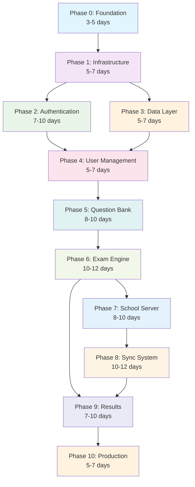

# CBT Platform — Build Phases Overview

**Version:** 1.0  
**Date:** October 14, 2026  
**Status:** Implementation Roadmap  
**Companion Documents:** CBT-Backend-Architecture.md, CBT-Database-Architecture.md

---

## Table of Contents

1. [Implementation Strategy](#1-implementation-strategy)
2. [Phase Dependencies](#2-phase-dependencies)
3. [Timeline & Resources](#3-timeline--resources)
4. [Quality Gates](#4-quality-gates)
5. [Phase Summaries](#5-phase-summaries)

---

## 1. Implementation Strategy

### 1.1 Build Philosophy

The CBT Platform backend will be built using a **progressive enhancement approach** over **10 structured phases**, each building upon the previous foundation while maintaining independent verification and rollback capabilities.

### 1.2 Key Principles

- **Quality First**: Each phase must pass comprehensive verification before proceeding
- **Security by Design**: Security considerations integrated from Phase 0
- **Performance Aware**: Performance benchmarks defined and tested at each phase
- **Rollback Ready**: Clear rollback procedures if quality gates fail
- **Independent Verification**: Each phase has objective success criteria

### 1.3 Documentation Structure

Each phase has its own detailed document:
- `CBT-Phase-0-Foundation.md` - Project setup and tooling
- `CBT-Phase-1-Infrastructure.md` - Core services and utilities
- `CBT-Phase-2-Authentication.md` - Security and access control
- `CBT-Phase-3-DataLayer.md` - Database and ORM setup
- `CBT-Phase-4-UserManagement.md` - User operations and roles
- `CBT-Phase-5-QuestionBank.md` - Question management system
- `CBT-Phase-6-ExamEngine.md` - Exam creation and delivery
- `CBT-Phase-7-SchoolServer.md` - Offline exam platform
- `CBT-Phase-8-SyncSystem.md` - Bidirectional synchronization
- `CBT-Phase-9-Results.md` - Results processing and analytics
- `CBT-Phase-10-Production.md` - Monitoring and deployment

---

## 2. Phase Dependencies

### 2.1 Dependency Graph

### 2.2 Critical Path

The **critical path** for minimum viable product (MVP):
- Phase 0 → Phase 1 → Phase 3 → Phase 4 → Phase 5 → Phase 6 → Phase 9

**Optional for MVP but recommended for production:**
- Phase 2 (can use basic auth initially)
- Phase 7 + 8 (school server and sync - can start cloud-only)
- Phase 10 (production tooling - can deploy manually initially)

### 2.3 Parallel Development Opportunities

After Phase 1 completion, these phases can be developed in parallel:
- **Track A**: Phase 2 (Authentication) + Phase 3 (Data Layer)
- **Track B**: Phase 5 (Question Bank) can start after Phase 4
- **Track C**: Phase 7 (School Server) can start after Phase 6

---

## 3. Timeline & Resources

### 3.1 Estimated Timeline

| Phase | Duration | Complexity | Risk Level | Team Size |
|-------|----------|------------|------------|-----------|
| Phase 0: Foundation | 3-5 days | Low | Low | 1-2 devs |
| Phase 1: Infrastructure | 5-7 days | Medium | Low | 2-3 devs |
| Phase 2: Authentication | 7-10 days | High | Medium | 2-3 devs (1 security) |
| Phase 3: Data Layer | 5-7 days | Medium | Low | 2 devs |
| Phase 4: User Management | 5-7 days | Medium | Low | 2-3 devs |
| Phase 5: Question Bank | 8-10 days | High | Medium | 3-4 devs |
| Phase 6: Exam Engine | 10-12 days | Very High | High | 4-5 devs |
| Phase 7: School Server | 8-10 days | High | Medium | 2-3 devs |
| Phase 8: Sync System | 10-12 days | Very High | High | 3-4 devs |
| Phase 9: Results | 7-10 days | High | Medium | 3 devs |
| Phase 10: Production | 5-7 days | Medium | Medium | 2-3 devs (1 DevOps) |

**Total Estimated Time:** 12-14 weeks (84-98 days)

### 3.2 Team Composition Recommendations

**Core Team (4-5 people):**
- **Lead Backend Developer** - Architecture decisions, code reviews
- **Security Specialist** - Authentication, authorization, security audits
- **Database Specialist** - Schema design, query optimization, migrations
- **Full-Stack Developer** - API integration, testing, documentation
- **DevOps Engineer** - Infrastructure, CI/CD, monitoring (joins Phase 10)

**Additional Resources:**
- **Senior Developer** (Phases 6, 8) - Complex exam engine and sync logic
- **QA Specialist** - Testing strategy, verification procedures
- **Technical Writer** - Documentation, API specs, user guides

### 3.3 Risk Mitigation

| Risk Category | Mitigation Strategy |
|---------------|-------------------|
| **Technical Complexity** | Prototype complex algorithms in Phase 1, validate early |
| **Security Vulnerabilities** | Security review at each phase, penetration testing |
| **Performance Issues** | Load testing at Phase 1, continuous monitoring |
| **Integration Problems** | API contracts defined early, mock services |
| **Timeline Overruns** | Buffer time in estimates, parallel development |

---

## 4. Quality Gates

### 4.1 Phase Completion Criteria

Each phase must meet ALL criteria before proceeding:

✅ **Functional Requirements**: All features work as specified  
✅ **Non-Functional Requirements**: Performance, security, reliability met  
✅ **Test Coverage**: >95% for business logic, >80% overall  
✅ **Documentation**: Implementation docs, API specs, deployment guides  
✅ **Security Review**: Vulnerability scan passes, security review approved  
✅ **Performance Verification**: All benchmarks met under load  
✅ **Integration Tests**: All API endpoints and database operations work  

### 4.2 Rollback Procedures

If any quality gate fails:

1. **Stop Development**: Do not proceed to next phase
2. **Root Cause Analysis**: Identify why quality gate failed
3. **Fix vs Rollback Decision**: 
   - If fix is < 2 days effort: Fix and re-verify
   - If fix is > 2 days: Consider rollback to previous stable state
4. **Re-verification**: Complete verification process again
5. **Lessons Learned**: Update procedures to prevent recurrence

### 4.3 Success Metrics

| Metric | Target | Measurement |
|--------|---------|-------------|
| **Code Quality** | >4.5/5 SonarQube rating | Automated analysis |
| **Test Coverage** | >95% business logic | Coverage reports |
| **Performance** | <200ms API response (95th percentile) | Load testing |
| **Security** | Zero critical, <5 high severity issues | Security scans |
| **Documentation** | >90% API coverage | Documentation audits |
| **Reliability** | >99.9% uptime in staging | Monitoring data |

---

## 5. Phase Summaries

### Phase 0: Foundation & Setup (3-5 days)
**Goal:** Establish development environment and project structure  
**Key Outputs:** Monorepo, CI/CD pipeline, development tooling  
**Risk Level:** Low  
**Dependencies:** None  

### Phase 1: Core Infrastructure (5-7 days)
**Goal:** Build foundational services and shared utilities  
**Key Outputs:** NestJS apps, exam algorithms, configuration system  
**Risk Level:** Low  
**Dependencies:** Phase 0  

### Phase 2: Authentication & Authorization (7-10 days)
**Goal:** Implement secure multi-factor authentication and RBAC  
**Key Outputs:** Auth service, MFA, session management, permissions  
**Risk Level:** Medium  
**Dependencies:** Phase 1  

### Phase 3: Data Layer & ORM (5-7 days)
**Goal:** Setup database connections, entities, and migrations  
**Key Outputs:** TypeORM entities, repositories, database utilities  
**Risk Level:** Low  
**Dependencies:** Phase 1  

### Phase 4: User Management (5-7 days)
**Goal:** Implement user CRUD operations and role management  
**Key Outputs:** User service, invitation system, role assignments  
**Risk Level:** Low  
**Dependencies:** Phase 2 + 3  

### Phase 5: Question Bank System (8-10 days)
**Goal:** Build comprehensive question management system  
**Key Outputs:** Question types, import/export, search, tagging  
**Risk Level:** Medium  
**Dependencies:** Phase 4  

### Phase 6: Exam Engine (10-12 days)
**Goal:** Create exam creation and delivery system  
**Key Outputs:** Exam builder, pack generation, shuffling, delivery  
**Risk Level:** High  
**Dependencies:** Phase 5  

### Phase 7: School Server (8-10 days)
**Goal:** Build offline exam delivery platform  
**Key Outputs:** Local NestJS server, SQLite storage, exam delivery  
**Risk Level:** Medium  
**Dependencies:** Phase 6  

### Phase 8: Sync System (10-12 days)
**Goal:** Implement bidirectional cloud-school synchronization  
**Key Outputs:** Sync engine, conflict resolution, batch processing  
**Risk Level:** High  
**Dependencies:** Phase 7  

### Phase 9: Results & Analytics (7-10 days)
**Goal:** Build results processing and reporting system  
**Key Outputs:** Marking engine, grade books, analytics, notifications  
**Risk Level:** Medium  
**Dependencies:** Phase 6 + 8  

### Phase 10: Monitoring & Production (5-7 days)
**Goal:** Implement production monitoring and deployment  
**Key Outputs:** Logging, metrics, alerts, deployment scripts  
**Risk Level:** Medium  
**Dependencies:** Phase 9  

---

## 6. Getting Started

To begin implementation:

1. **Read Phase 0 document**: `docs/CBT-Phase-0-Foundation.md`
2. **Setup development environment** following Phase 0 instructions
3. **Execute Phase 0 implementation prompt**
4. **Run Phase 0 verification checklist**
5. **Only proceed to Phase 1 after all Phase 0 criteria are met**

---

## 7. Success Criteria for Complete Project

The CBT Platform backend is considered complete when:

✅ **All 10 phases pass verification**  
✅ **End-to-end workflows function correctly**  
✅ **Performance targets met under load**  
✅ **Security audit passes with no critical issues**  
✅ **Production deployment successful**  
✅ **Comprehensive documentation delivered**  
✅ **Team trained on maintenance procedures**  

**Next Steps After Completion:**
- Frontend integration
- Mobile app development  
- Advanced analytics features
- Multi-tenancy enhancements
- International deployment