# CBT-School Platform Infrastructure Analysis

**Version:** 1.0  
**Date:** October 17, 2026  
**Status:** Comprehensive Infrastructure Documentation

Based on thorough review of all documentation in the CBT-School project, this document explains how the entire system is architected and how each component communicates.

---

## Table of Contents

1. [Executive Summary](#1-executive-summary)
2. [System Context (C4 Level 1)](#2-system-context-c4-level-1)
3. [Backend (Cloud API)](#3-backend-cloud-api)
4. [School Exam Server (Offline Server)](#4-school-exam-server-offline-server)
5. [Exam Client (Student Interface)](#5-exam-client-student-interface)
6. [Windows Service & Installer](#6-windows-service--installer)
7. [Component Communication Architecture](#7-component-communication-architecture)
8. [Cloud ↔ School Server Flow](#8-cloud--school-server-flow)
9. [Exam Client ↔ School Server Flow](#9-exam-client--school-server-flow)
10. [Offline School Server & SQLite Database](#10-offline-school-server--sqlite-database)
11. [Sync Event Types](#11-sync-event-types)
12. [Key Communication Protocols](#12-key-communication-protocols)
13. [Fault Tolerance & Recovery](#13-fault-tolerance--recovery)
14. [Container Architecture (C4 Level 2)](#14-container-architecture-c4-level-2)
15. [Deployment Architecture](#15-deployment-architecture)

---

## 1. Executive Summary

The CBT Platform uses a **hybrid cloud-edge architecture** where:

- **Cloud** owns all setup, content, and result release logic
- **School server** owns live exam sessions, answers, and raw scores
- **Exam clients** are thin web interfaces served from the school server
- **Communication** is unidirectional from cloud to school (roster/packs), and upstream only for results/sync events
- **SQLite** on the school server provides crash-safe, offline-first storage with WAL mode
- **All sync** is initiated by the school server (cloud never pushes to school behind NAT)
- **Zero data loss** tolerance through combination of SQLite FULL synchronous writes, browser IndexedDB buffering, and idempotent sync events

This infrastructure supports 200+ concurrent students per school server, works completely offline during exams, and synchronizes results when internet becomes available, with comprehensive fault tolerance and recovery procedures.

---

## 2. System Context (C4 Level 1)

### 2.1 Overall System Context

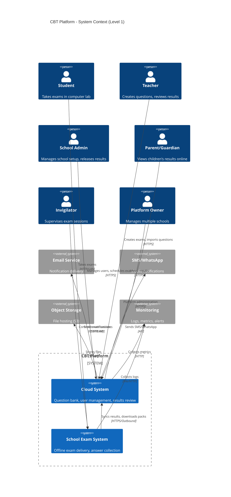

### 2.2 Key Design Principles

| Principle | Implementation |
|-----------|----------------|
| **Single Writer Per Record** | Cloud owns setup/questions, School owns sessions/answers — no conflicts |
| **Eventual Consistency** | School syncs when online; exams never wait for cloud |
| **Zero Data Loss** | SQLite `PRAGMA synchronous=FULL`; PostgreSQL with WAL archiving |
| **Multi-Tenancy** | Every table has `school_id` with RLS enforcement |
| **Audit Immutability** | Separate write-only role for audit logs |
| **Performance First** | Strategic indexes, materialized views, connection pooling |

---

## 3. Backend (Cloud API)

### 3.1 Technology Stack

| Component | Technology | Purpose |
|-----------|------------|---------|
| **Framework** | NestJS on Node.js LTS | REST API, business logic, modules |
| **Database** | PostgreSQL 15+ | Multi-tenant, ACID, advanced indexing |
| **Extensions** | `uuid-ossp`, `citext`, `pg_trgm`, `btree_gin` | UUID generation, case-insensitive text, trigram search |
| **Cache/Queue** | Redis + BullMQ | Sessions, jobs, cache, email/SMS workers |
| **Storage** | S3-compatible (MinIO in dev) | Images, packs, backups |
| **Reverse Proxy** | Caddy | TLS termination, routing |
| **ORM** | Drizzle ORM + drizzle-kit | Type-safe queries, migrations |
| **Frontend** | Next.js (App Router) | Admin, Teacher, Parent portals |

### 3.2 Core Modules

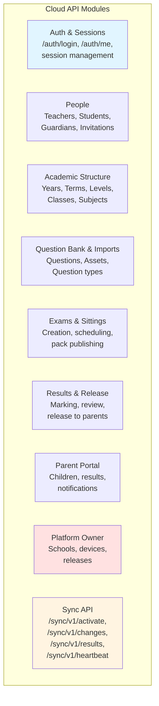

### 3.3 Data Ownership (Cloud)

| Data Type | Cloud Ownership | Sync Direction |
|-----------|-----------------|----------------|
| Schools, Users, Teachers | ✅ Owner | — |
| Students, Codes | ✅ Owner | Down (read-only copy to school) |
| Guardians, Parents | ✅ Owner | Never sent to school (privacy) |
| Questions, Answer Keys | ✅ Owner | Down (encrypted in packs only) |
| Exams, Sittings | ✅ Owner | Down (read-only copy to school) |
| Results (reviewed) | ✅ Owner | Not sent back to school |
| Audit logs (cloud actions) | ✅ Owner | — |

### 3.4 Cloud Database Schema (PostgreSQL)

#### 3.4.1 Tenancy and Identity

```sql
-- Schools (Tenant Root)
CREATE TABLE schools (
  id            TEXT PRIMARY KEY,
  code          TEXT NOT NULL UNIQUE CHECK (code ~ '^[A-Z0-9]{3,6}$'),
  name          TEXT NOT NULL,
  address       TEXT,
  logo_asset_id TEXT,
  timezone      TEXT NOT NULL DEFAULT 'Africa/Lagos',
  grade_scale_id TEXT,
  status        TEXT NOT NULL DEFAULT 'active',
  created_at    TIMESTAMPTZ NOT NULL DEFAULT NOW()
);

-- Users (All human accounts except students)
CREATE TABLE users (
  id             TEXT PRIMARY KEY,
  school_id      TEXT REFERENCES schools(id),
  role           TEXT NOT NULL CHECK (role IN ('platform_owner','school_admin','teacher','parent','bursar')),
  full_name      TEXT NOT NULL,
  email          CITEXT,
  phone_e164     TEXT,
  password_hash  TEXT,
  status         TEXT NOT NULL DEFAULT 'invited',
  totp_secret_enc BYTEA,
  created_at     TIMESTAMPTZ NOT NULL DEFAULT NOW()
);

-- Sessions (Web login sessions)
CREATE TABLE sessions (
  id          TEXT PRIMARY KEY,
  user_id     TEXT NOT NULL REFERENCES users(id),
  token_hash    TEXT NOT NULL,
  created_at    TIMESTAMPTZ NOT NULL DEFAULT NOW(),
  expires_at    TIMESTAMPTZ NOT NULL,
  last_seen_at  TIMESTAMPTZ
);
```

#### 3.4.2 Students and Guardians

```sql
-- Students (No login accounts)
CREATE TABLE students (
  id             TEXT PRIMARY KEY,
  school_id      TEXT NOT NULL REFERENCES schools(id),
  admission_no   TEXT NOT NULL,
  first_name     TEXT NOT NULL,
  last_name      TEXT NOT NULL,
  other_names    TEXT,
  gender         TEXT CHECK (gender IN ('M','F')),
  date_of_birth  DATE,
  status         TEXT NOT NULL DEFAULT 'active',
  UNIQUE (school_id, admission_no)
);

-- Student Codes (Exam login codes)
CREATE TABLE student_codes (
  id          TEXT PRIMARY KEY,
  student_id  TEXT NOT NULL REFERENCES students(id),
  code        TEXT NOT NULL UNIQUE CHECK (length(code) BETWEEN 12 AND 20),
  status      TEXT NOT NULL DEFAULT 'active',
  issued_at   TIMESTAMPTZ NOT NULL DEFAULT NOW()
);

-- Guardians (Parent records before account activation)
CREATE TABLE guardians (
  id          TEXT PRIMARY KEY,
  school_id   TEXT NOT NULL REFERENCES schools(id),
  user_id     TEXT UNIQUE REFERENCES users(id),
  full_name   TEXT NOT NULL,
  email       CITEXT,
  phone_e164  TEXT,
  created_at  TIMESTAMPTZ NOT NULL DEFAULT NOW()
);

-- Guardianships (One parent ↔ many children)
CREATE TABLE guardianships (
  guardian_id      TEXT NOT NULL REFERENCES guardians(id),
  student_id       TEXT NOT NULL REFERENCES students(id),
  relationship     TEXT,
  can_view_results BOOLEAN NOT NULL DEFAULT TRUE,
  PRIMARY KEY (guardian_id, student_id)
);
```

#### 3.4.3 Academic Structure

```sql
CREATE TABLE academic_years (
  id          TEXT PRIMARY KEY,
  school_id   TEXT NOT NULL REFERENCES schools(id),
  name        TEXT NOT NULL,
  starts_on   DATE,
  ends_on     DATE,
  is_current  BOOLEAN NOT NULL DEFAULT FALSE
);

CREATE TABLE terms (
  id                TEXT PRIMARY KEY,
  academic_year_id  TEXT NOT NULL REFERENCES academic_years(id),
  name              TEXT NOT NULL,
  starts_on         DATE,
  ends_on           DATE,
  is_current        BOOLEAN NOT NULL DEFAULT FALSE
);

CREATE TABLE levels (
  id          TEXT PRIMARY KEY,
  school_id   TEXT NOT NULL REFERENCES schools(id),
  name        TEXT NOT NULL,
  section     TEXT CHECK (section IN ('primary','secondary')),
  sort_order  INT
);

CREATE TABLE classes (
  id                TEXT PRIMARY KEY,
  school_id         TEXT NOT NULL REFERENCES schools(id),
  level_id          TEXT NOT NULL REFERENCES levels(id),
  name              TEXT NOT NULL,
  academic_year_id  TEXT NOT NULL REFERENCES academic_years(id),
  form_teacher_id   TEXT REFERENCES users(id)
);

CREATE TABLE subjects (
  id          TEXT PRIMARY KEY,
  school_id   TEXT NOT NULL REFERENCES schools(id),
  name        TEXT NOT NULL,
  code        TEXT,
  UNIQUE (school_id, name)
);

CREATE TABLE class_subjects (
  class_id    TEXT NOT NULL REFERENCES classes(id),
  subject_id  TEXT NOT NULL REFERENCES subjects(id),
  teacher_id  TEXT NOT NULL REFERENCES users(id),
  PRIMARY KEY (class_id, subject_id, teacher_id)
);
```

#### 3.4.4 Question Bank

```sql
CREATE TABLE questions (
  id            TEXT PRIMARY KEY,
  school_id     TEXT NOT NULL REFERENCES schools(id),
  subject_id    TEXT NOT NULL REFERENCES subjects(id),
  level_id      TEXT REFERENCES levels(id),
  type          TEXT NOT NULL CHECK (type IN ('single_choice','multi_choice','true_false','fill_blank')),
  stem          TEXT NOT NULL,
  explanation   TEXT,
  marks         NUMERIC(5,2) NOT NULL DEFAULT 1,
  difficulty    TEXT CHECK (difficulty IN ('easy','medium','hard')),
  topic         TEXT,
  fill_answers  JSONB,
  status        TEXT NOT NULL DEFAULT 'draft' CHECK (status IN ('draft','approved','retired')),
  supersedes_id TEXT REFERENCES questions(id),
  version       INT NOT NULL DEFAULT 1,
  created_by    TEXT NOT NULL REFERENCES users(id),
  created_at    TIMESTAMPTZ NOT NULL DEFAULT NOW()
);

CREATE TABLE question_options (
  id          TEXT PRIMARY KEY,
  question_id TEXT NOT NULL REFERENCES questions(id),
  label       TEXT NOT NULL,
  body        TEXT NOT NULL,
  is_correct  BOOLEAN NOT NULL DEFAULT FALSE,
  sort_order  INT NOT NULL
);
```

#### 3.4.5 Exams and Packs

```sql
CREATE TABLE exams (
  id                TEXT PRIMARY KEY,
  school_id         TEXT NOT NULL REFERENCES schools(id),
  title             TEXT NOT NULL,
  subject_id        TEXT NOT NULL REFERENCES subjects(id),
  term_id           TEXT REFERENCES terms(id),
  kind              TEXT NOT NULL DEFAULT 'exam',
  duration_min      INT NOT NULL,
  shuffle_questions  BOOLEAN NOT NULL DEFAULT TRUE,
  shuffle_options   BOOLEAN NOT NULL DEFAULT TRUE,
  negative_marking  BOOLEAN NOT NULL DEFAULT FALSE,
  pass_mark_pct     NUMERIC(5,2),
  instructions      TEXT,
  status            TEXT NOT NULL DEFAULT 'draft',
  created_by        TEXT NOT NULL REFERENCES users(id),
  created_at        TIMESTAMPTZ NOT NULL DEFAULT NOW()
);

CREATE TABLE exam_questions (
  exam_id         TEXT NOT NULL REFERENCES exams(id),
  question_id     TEXT NOT NULL REFERENCES questions(id),
  position        INT NOT NULL,
  marks_override  NUMERIC(5,2),
  PRIMARY KEY (exam_id, question_id)
);

CREATE TABLE sittings (
  id              TEXT PRIMARY KEY,
  school_id       TEXT NOT NULL REFERENCES schools(id),
  exam_id         TEXT NOT NULL REFERENCES exams(id),
  class_id        TEXT NOT NULL REFERENCES classes(id),
  window_start    TIMESTAMPTZ NOT NULL,
  window_end      TIMESTAMPTZ NOT NULL,
  extra_time_min  INT NOT NULL DEFAULT 0,
  status          TEXT NOT NULL DEFAULT 'scheduled',
  exam_key_hash   TEXT
);

CREATE TABLE exam_packs (
  id          TEXT PRIMARY KEY,
  exam_id     TEXT NOT NULL REFERENCES exams(id),
  version     INT NOT NULL,
  key_version INT NOT NULL,
  manifest    JSONB NOT NULL,
  storage_key TEXT NOT NULL,
  sha256      TEXT NOT NULL,
  signature   TEXT NOT NULL,
  created_at  TIMESTAMPTZ NOT NULL DEFAULT NOW(),
  UNIQUE (exam_id, version)
);
```

#### 3.4.6 Results and Sync

```sql
CREATE TABLE submissions (
  id              TEXT PRIMARY KEY,
  school_id       TEXT NOT NULL REFERENCES schools(id),
  sitting_id      TEXT NOT NULL REFERENCES sittings(id),
  student_id      TEXT NOT NULL REFERENCES students(id),
  exam_id         TEXT NOT NULL REFERENCES exams(id),
  pack_version    INT NOT NULL,
  seat            TEXT,
  started_at      TIMESTAMPTZ,
  submitted_at    TIMESTAMPTZ,
  submit_reason   TEXT,
  school_score    NUMERIC(7,2),
  UNIQUE (sitting_id, student_id)
);

CREATE TABLE results (
  id              TEXT PRIMARY KEY,
  submission_id   TEXT NOT NULL REFERENCES submissions(id),
  student_id      TEXT NOT NULL REFERENCES students(id),
  exam_id         TEXT NOT NULL REFERENCES exams(id),
  score           NUMERIC(7,2) NOT NULL,
  max_score       NUMERIC(7,2) NOT NULL,
  percent         NUMERIC(5,2) NOT NULL,
  grade           TEXT,
  status          TEXT NOT NULL DEFAULT 'draft',
  revision        INT NOT NULL DEFAULT 1,
  reviewed_by     TEXT REFERENCES users(id),
  released_by     TEXT REFERENCES users(id),
  released_at     TIMESTAMPTZ,
  created_at      TIMESTAMPTZ NOT NULL DEFAULT NOW()
);

CREATE TABLE sync_devices (
  id              TEXT PRIMARY KEY,
  school_id       TEXT NOT NULL REFERENCES schools(id),
  name            TEXT NOT NULL,
  key_id          TEXT NOT NULL UNIQUE,
  secret_enc      BYTEA NOT NULL,
  status          TEXT NOT NULL DEFAULT 'active',
  last_seen_at    TIMESTAMPTZ,
  last_version    TEXT,
  last_status     JSONB,
  activated_at    TIMESTAMPTZ
);

CREATE TABLE change_log (
  cursor      BIGSERIAL PRIMARY KEY,
  school_id   TEXT NOT NULL,
  entity      TEXT NOT NULL,
  entity_id   TEXT NOT NULL,
  op          TEXT NOT NULL CHECK (op IN ('upsert','delete')),
  payload     JSONB,
  at          TIMESTAMPTZ NOT NULL DEFAULT NOW()
);

CREATE TABLE sync_events (
  device_id    TEXT NOT NULL REFERENCES sync_devices(id),
  event_id     TEXT NOT NULL,
  type         TEXT NOT NULL,
  received_at  TIMESTAMPTZ NOT NULL DEFAULT NOW(),
  outcome      TEXT NOT NULL CHECK (outcome IN ('accepted','duplicate','rejected')),
  PRIMARY KEY (device_id, event_id)
);
```

### 3.5 Cloud API Architecture

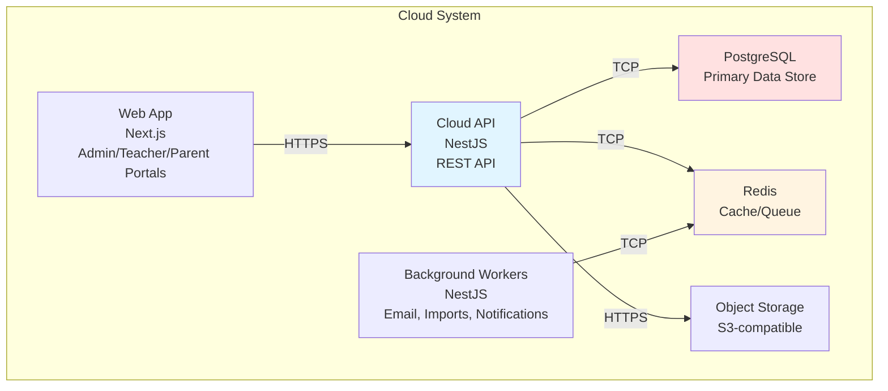

---

## 4. School Exam Server (Offline Server)

### 4.1 Technology Stack

| Component | Technology | Purpose |
|-----------|------------|---------|
| **Framework** | NestJS (same modules as cloud) | Reuses marking, auth, pack code |
| **Database** | SQLite 3.42+ (WAL mode) | Embedded, zero-admin, crash-proof |
| **ORM** | Drizzle ORM + better-sqlite3 | Synchronous database operations |
| **Static Files** | React + Vite | Exam client and console |
| **Scheduler** | node-cron | In-process backup/sync scheduling |
| **Service Wrapper** | WinSW | Windows service management |
| **Pack Format** | Encrypted with Ed25519 signatures | Secure exam distribution |

### 4.2 Core Components

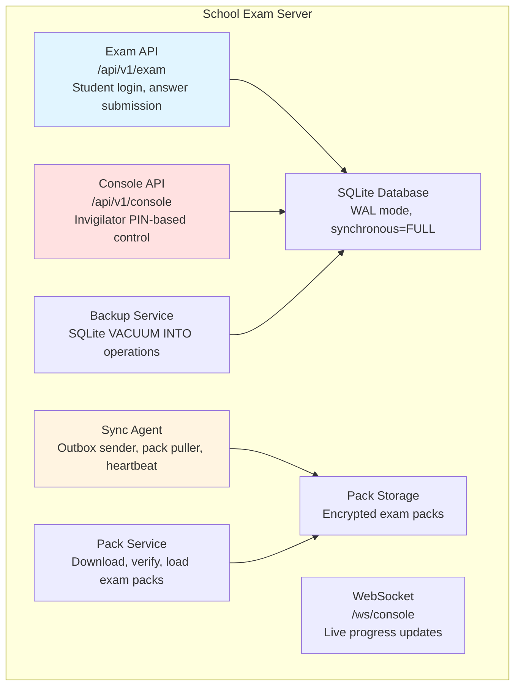

### 4.3 School Database Schema (SQLite)

File: `C:\ProgramData\SchoolCBT\data\school.db`

```sql
-- Critical Pragmas
PRAGMA journal_mode = WAL;
PRAGMA synchronous = FULL;    -- Every committed write survives power loss
PRAGMA foreign_keys = ON;
PRAGMA busy_timeout = 5000;
PRAGMA cache_size = -64000;   -- 64MB cache
PRAGMA mmap_size = 268435456; -- 256MB memory-mapped I/O

-- Meta (School configuration)
CREATE TABLE meta (
  key TEXT PRIMARY KEY,
  value TEXT NOT NULL
);

-- Roster (Read-only copy from cloud)
CREATE TABLE classes (
  id TEXT PRIMARY KEY,
  name TEXT NOT NULL
);

CREATE TABLE subjects (
  id TEXT PRIMARY KEY,
  name TEXT NOT NULL
);

CREATE TABLE students (
  id TEXT PRIMARY KEY,
  code TEXT NOT NULL UNIQUE,
  code_status TEXT NOT NULL,
  full_name TEXT NOT NULL,
  class_id TEXT REFERENCES classes(id),
  photo_path TEXT
);

-- Exams and Packs
CREATE TABLE exams (
  id TEXT PRIMARY KEY,
  title TEXT NOT NULL,
  subject_id TEXT REFERENCES subjects(id),
  duration_min INT NOT NULL,
  shuffle_questions BOOLEAN NOT NULL DEFAULT TRUE,
  shuffle_options BOOLEAN NOT NULL DEFAULT TRUE
);

CREATE TABLE packs (
  id TEXT PRIMARY KEY,
  exam_id TEXT REFERENCES exams(id),
  version INT NOT NULL,
  file_path TEXT NOT NULL,
  sha256 TEXT NOT NULL,
  loaded_at TIMESTAMPTZ,
  manifest JSONB
);

-- Sittings (One exam run)
CREATE TABLE sittings (
  id TEXT PRIMARY KEY,
  exam_id TEXT REFERENCES exams(id),
  class_id TEXT REFERENCES classes(id),
  window_start TEXT NOT NULL,
  window_end TEXT NOT NULL,
  key_hash TEXT NOT NULL,
  status TEXT NOT NULL DEFAULT 'scheduled',
  opened_at TEXT,
  closed_at TEXT
);

-- Sessions (One student attempt)
CREATE TABLE sessions (
  id TEXT PRIMARY KEY,
  sitting_id TEXT NOT NULL REFERENCES sittings(id),
  student_id TEXT NOT NULL REFERENCES students(id),
  seat TEXT,
  seed INT NOT NULL,
  state TEXT NOT NULL DEFAULT 'ready',
  started_at TEXT,
  ends_at TEXT,
  submitted_at TEXT,
  extra_time_min INT DEFAULT 0
);

-- Answers (Student responses)
CREATE TABLE answers (
  session_id TEXT NOT NULL REFERENCES sessions(id),
  question_id TEXT NOT NULL,
  value TEXT,
  seq INT NOT NULL,
  updated_at TEXT NOT NULL,
  PRIMARY KEY (session_id, question_id)
);

-- Results (Raw scores)
CREATE TABLE results (
  id TEXT PRIMARY KEY,
  session_id TEXT NOT NULL REFERENCES sessions(id),
  score NUMERIC(7,2) NOT NULL,
  max_score NUMERIC(7,2) NOT NULL,
  pack_version INT NOT NULL,
  key_version INT NOT NULL,
  created_at TEXT NOT NULL
);

-- Outbox (Events waiting to sync)
CREATE TABLE outbox (
  id TEXT PRIMARY KEY,
  type TEXT NOT NULL,
  payload TEXT NOT NULL,
  created_at TEXT NOT NULL,
  sent_at TEXT,
  attempts INT DEFAULT 0,
  last_error TEXT
);

-- Sync State
CREATE TABLE sync_state (
  key TEXT PRIMARY KEY,
  value TEXT NOT NULL
);

-- Audit Log (Console actions)
CREATE TABLE audit_log (
  id INTEGER PRIMARY KEY AUTOINCREMENT,
  actor TEXT NOT NULL,
  action TEXT NOT NULL,
  entity TEXT,
  entity_id TEXT,
  payload TEXT,
  at TEXT NOT NULL
);

-- Backup Log
CREATE TABLE backup_log (
  id INTEGER PRIMARY KEY AUTOINCREMENT,
  file_path TEXT NOT NULL,
  checksum TEXT NOT NULL,
  size_bytes INT NOT NULL,
  taken_at TEXT NOT NULL
);
```

### 4.4 Data Ownership (School)

| Data Type | School Ownership | Sync Direction |
|-----------|------------------|----------------|
| Sessions, Answers | ✅ Owner | Up (results only) |
| Scores (raw) | ✅ Owner | Up |
| Seat States | ✅ Owner | — |
| Outbox events | ✅ Owner | Up |
| Sync cursor | ✅ Owner | — |
| Audit logs (console) | ✅ Owner | Up (console logs) |
| Backup logs | ✅ Owner | — |

### 4.5 Installed Structure

```
C:\Program Files\SchoolCBT\
  node.exe (bundled runtime)
  app/server.cjs (bundled school server)
  app/exam-client/ (static files)
  app/console/ (static PIN page)
  SchoolCBT.exe (WinSW wrapper)
  SchoolCBT.xml (service config)
  tools/ (firewall/power/uninstall scripts)

C:\ProgramData\SchoolCBT\
  data/school.db (SQLite with WAL)
  packs/ (verified exam packs)
  backups/ (local backups, last 30 kept)
  logs/ (rotating logs)
  config.json (port, cloud URL, second backup path)
  secrets/device.bin (device secret, DPAPI machine scope)
```

---

## 5. Exam Client (Student Interface)

### 5.1 Technology Stack

| Component | Technology | Purpose |
|-----------|------------|---------|
| **Framework** | React + Vite | SPA built to static files |
| **Build Target** | Chrome 109 | Supports Windows 7/8 |
| **Storage** | IndexedDB + localStorage | Offline answer buffering |
| **Math Rendering** | KaTeX (bundled) | Maths display, no CDN |
| **Styling** | Tailwind CSS | Responsive design |
| **Communication** | Plain HTTP | No HTTPS needed on LAN |

### 5.2 Exam Client Architecture

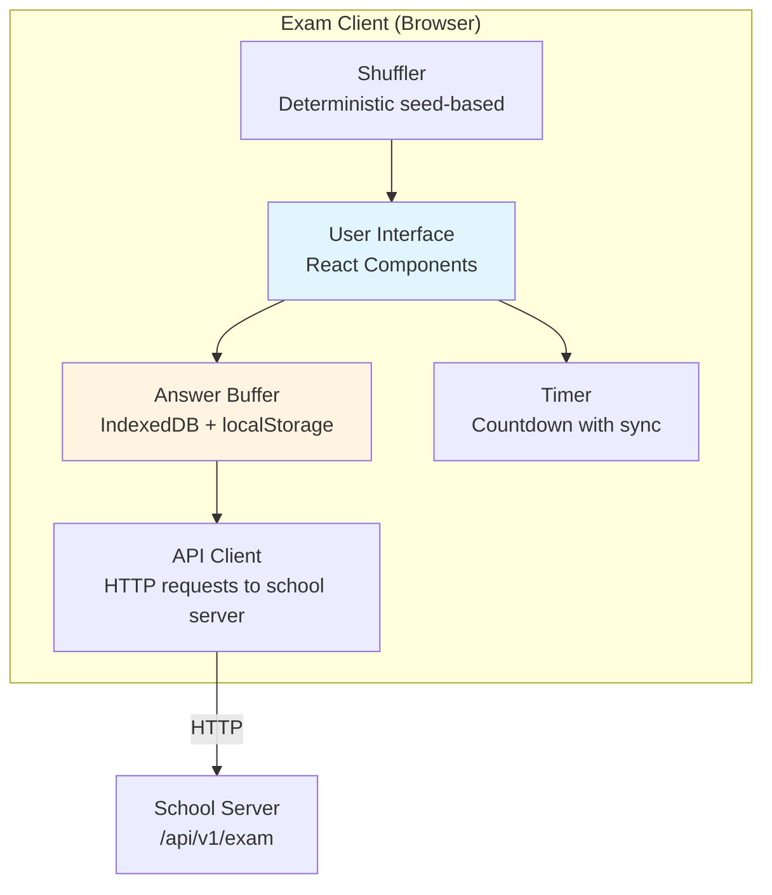

### 5.3 Communication Flow

1. **Login:** Student enters `student code` + `exam key` at login
2. **Validation:** Server validates code against roster, checks student class assignment
3. **Session Creation:** Session created, bound to seat; deterministic seed generated
4. **Question Download:** Question set downloaded with shuffled order (seed stored in session)
5. **Answer Autosave:** Student answers auto-saved every ~30 seconds with sequence numbers
6. **Submission:** At exam end: server marks objective questions, queues result for sync
7. **Offline Resilience:**
   - Client buffers answers in IndexedDB → localStorage → fallback
   - Server only saves answer if new sequence > stored sequence
   - Network failure: client shows "Connection lost. Your answers are kept on this PC"
   - Server restart: committed answers survive via SQLite `synchronous=FULL`
   - Session recovery: same code + key → returns saved answers + remaining time

### 5.4 Answer Autosave Algorithm

```typescript
// Client-side answer autosave with sequence numbers
class AnswerAutosave {
  private buffer: Map<string, Answer> = new Map();
  private sequence: number = 0;
  private lastAcknowledged: number = 0;
  
  async saveAnswer(questionId: string, value: any): Promise<void> {
    // Update local buffer
    this.buffer.set(questionId, value);
    this.sequence++;
    
    // Persist to IndexedDB
    await this.persistToIndexedDB();
    
    // Send to server
    try {
      const response = await fetch(`/api/v1/sessions/${this.sessionId}/answers`, {
        method: 'PUT',
        headers: { 'Content-Type': 'application/json' },
        body: JSON.stringify({
          question_id: questionId,
          value: value,
          seq: this.sequence
        })
      });
      
      if (response.ok) {
        const data = await response.json();
        this.lastAcknowledged = data.ack_seq;
      }
    } catch (error) {
      // Network error - keep working, retry with backoff
      this.scheduleRetry();
    }
  }
  
  async resumeSession(): Promise<void> {
    // Load from IndexedDB on resume
    const saved = await this.loadFromIndexedDB();
    this.buffer = new Map(saved.answers);
    this.sequence = saved.sequence;
    
    // Sync with server
    const serverState = await fetch(`/api/v1/sessions/${this.sessionId}`);
    const serverAnswers = await serverState.json();
    
    // Merge: server sequence wins, keep local if newer
    this.mergeAnswers(serverAnswers);
  }
}
```

---

## 6. Windows Service & Installer

### 6.1 Installer Components

The installer (`SchoolCBT-Setup.exe`) is built with Inno Setup and performs the following:

```mermaid
graph TB
    subgraph "Installer Process"
        Install["Run Installer.exe"]
        CopyFiles["Copy Files to<br/>C:\Program Files\SchoolCBT"]
        CreateDataFolder["Create Data Folder<br/>C:\ProgramData\SchoolCBT"]
        RegisterService["Register Windows Service<br/>WinSW"]
        FirewallRule["Add Firewall Rule<br/>Port 8080, Private Network"]
        DisableSleep["Disable Sleep/Hibernate"]
        CreateBackupTask["Create Nightly Backup Task"]
        OpenSetup["Open Setup Page<br/>Activation + PIN"]
        FirstSync["First Sync<br/>Pull Roster + Packs"]
    end
    
    Install --> CopyFiles
    CopyFiles --> CreateDataFolder
    CreateDataFolder --> RegisterService
    RegisterService --> FirewallRule
    FirewallRule --> DisableSleep
    DisableSleep --> CreateBackupTask
    CreateBackupTask --> OpenSetup
    OpenSetup --> FirstSync
    
    style Install fill:#e1f5ff
    style FirstSync fill:#c8e6c9
```

### 6.2 Installer Details

| Setting | Value |
|---------|-------|
| **Target directory** | `C:\Program Files\SchoolCBT` |
| **Data directory** | `C:\ProgramData\SchoolCBT` |
| **Service name** | `SchoolCBT` (WinSW wrapper) |
| **Service executable** | `%BASE%\node.exe` with arguments `"%BASE%\app\server.cjs"` |
| **Firewall rule** | Inbound, private network profile, port 8080 (configurable) |
| **Power settings** | Disable sleep and hibernate, start service on boot |
| **Code signing** | Required to avoid Windows SmartScreen warnings (recurring cost) |
| **Silent install flags** | Available for automated deployment |

### 6.3 Service Configuration

```xml
<service>
  <id>SchoolCBT</id>
  <name>School CBT Exam Server</name>
  <description>Runs the school's offline exams.</description>
  <executable>%BASE%\node.exe</executable>
  <arguments>"%BASE%\app\server.cjs"</arguments>
  <workingDirectory>%BASE%</workingDirectory>
  <logMode>reset</logMode>
  <waitStartDelay>5000</waitStartDelay>
  <startmode>Automatic</startmode>
</service>
```

### 6.4 Backup and Restore

**Backup Strategy:**
- Nightly and after each sitting: Using SQLite backup API, copied to external drive and second folder
- Backup files: Checksummed, last 30 kept
- When online: Encrypted copy of latest backup uploaded to cloud

**Restore Procedure:**
1. Install on spare PC
2. Activate with replacement code
3. Choose restore from backup or from cloud
4. Check pack and roster versions

**Cloud Backup:**
- Daily database dumps to object storage
- 30-day retention
- Restore tested monthly

### 6.5 Remote Support

- Request school to allow remote access through VPN (Tailscale or WireGuard) or trusted remote-support tool
- Without remote access, every fix requires a site visit

### 6.6 Monitoring

- School server sends heartbeat to cloud: version, packs held, disk space, last backup, clock offset
- Platform Owner dashboard shows every school's last heartbeat and flags problems
- Console shows same information locally

---

## 7. Component Communication Architecture

### 7.1 High-Level Communication Flow

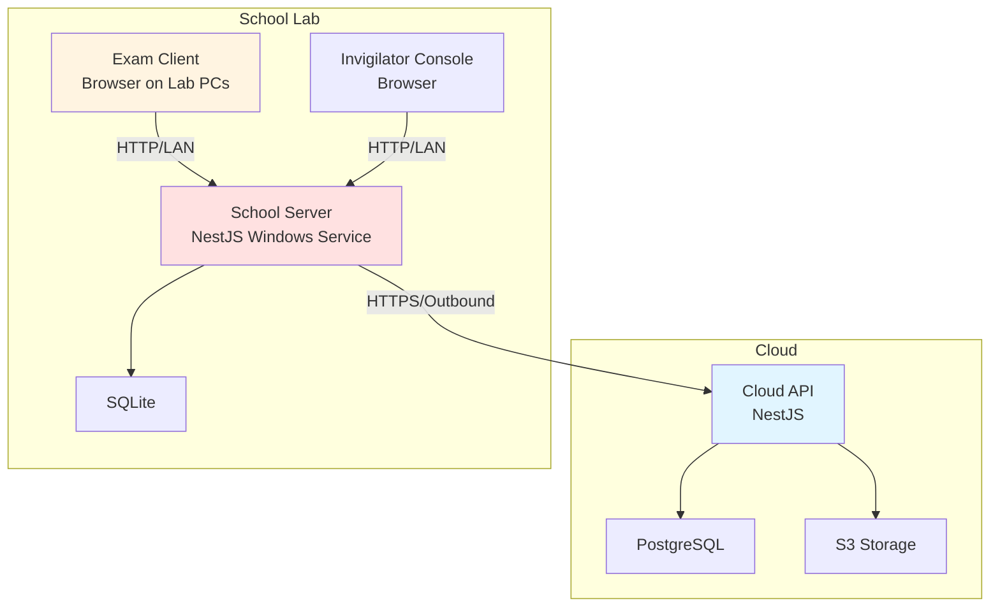

### 7.2 Communication Protocols Summary

| Communication | Protocol | Direction | Authentication |
|---------------|----------|----------|----------------|
| Cloud portals → Cloud API | HTTPS | Bi-directional | HttpOnly cookies + CSRF |
| School server → Cloud Sync API | HTTPS | Outbound only | HMAC-SHA256 signatures |
| Exam client → School Exam API | HTTP | Bi-directional | Bearer token |
| Console → School Console API | HTTP | Bi-directional | Bearer token |
| Console → School WebSocket | WS | Bi-directional | Bearer token |
| School server → Object Storage | HTTPS | Bi-directional | Signed URLs |

---

## 8. Cloud ↔ School Server Flow

### 8.1 Downstream (Cloud → School)

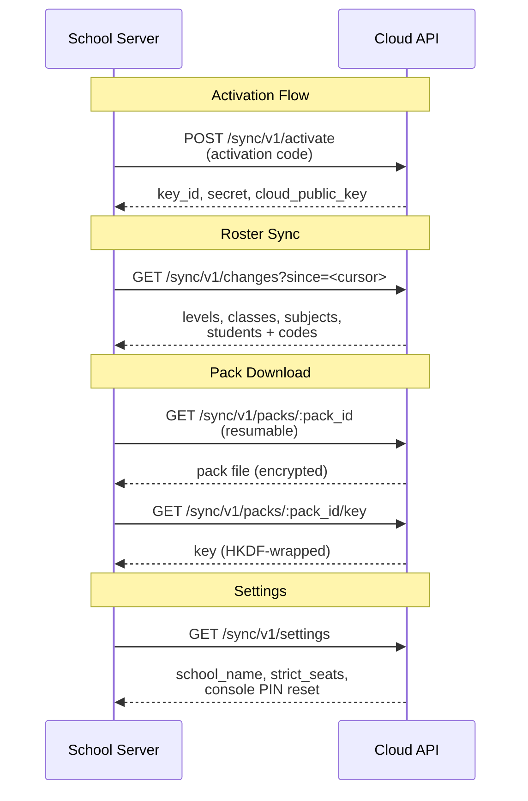

### 8.2 Upstream (School → Cloud)

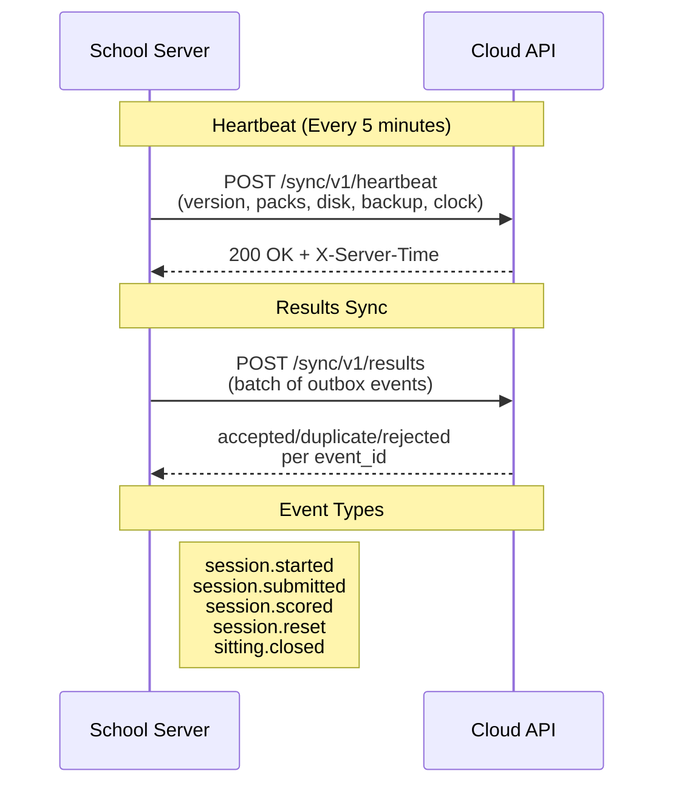

### 8.3 Sync Protocol Details

**Authentication Headers:**
- `X-Key-Id`: Device key identifier
- `X-Timestamp`: Unix timestamp in seconds
- `X-Nonce`: Random 16-byte base64 string
- `X-Signature`: HMAC-SHA256 signature
- `X-Sync-Protocol: 1`

**String to Sign:**
```
v1
METHOD
path_and_query
timestamp
nonce
sha256_hex(body_bytes_on_the_wire)
```

**Clock Skew:**
- 5-minute tolerance
- Response header `X-Server-Time` for clock correction
- Over 300 seconds → 401 CLOCK_SKEW with server_time

**Pack Verification:**
- Ed25519 signature over manifest
- SHA-256 hash verification for each asset
- Pack key unwrapping: AES-256-GCM with HKDF, derived from device secret

**Retry Strategy:**
- Exponential backoff on failures
- Never delete unsent rows
- Idempotency via `event_id` in `sync_events` table

---

## 9. Exam Client ↔ School Server Flow

### 9.1 Exam Day Communication

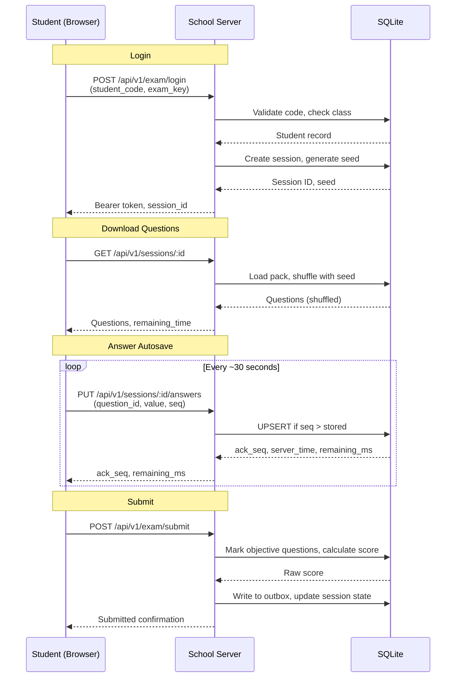

### 9.2 Offline Resilience

| Scenario | Behavior |
|----------|----------|
| **Network failure** | Client shows "Connection lost. Your answers are kept on this PC". Answers buffered in IndexedDB |
| **Server restart** | Committed answers survive via SQLite `synchronous=FULL`. At most last few seconds at risk |
| **PC crash** | Student logs in again with same code + key. Server returns saved answers + remaining time |
| **Sequence conflict** | Server only saves if new sequence > stored sequence. Prevents rollback attacks |
| **Session timeout** | Server expires sessions automatically. Expired session submitted with last saved answers |

### 9.3 Exam Lifecycle

| Stage | Where | What happens |
|-------|-------|--------------|
| **Draft** | Cloud | Teacher builds the exam from the question bank or an import |
| **Scheduled** | Cloud | Admin sets date, window and lab seats |
| **Frozen** | Cloud | 24 hours before the start the exam locks. A later edit creates a new pack version |
| **Pack published** | Cloud | A signed pack is built and made available |
| **Pack loaded** | School | Server pulls the pack. Console shows version and checksum |
| **Sitting open** | School | Invigilator opens the sitting. A fresh exam key is generated |
| **In progress** | School | Students log in and answer |
| **Closed** | School | Window ends or invigilator closes the sitting. Open sessions are submitted |
| **Marked** | School | Objective questions scored on the server |
| **Synced** | Both | Results copied to the cloud |
| **Reviewed** | Cloud | Teacher reviews, can re-mark after a key correction |
| **Released** | Cloud | Admin or Class Teacher releases. Parents are notified |

---

## 10. Offline School Server & SQLite Database

### 10.1 Database Architecture

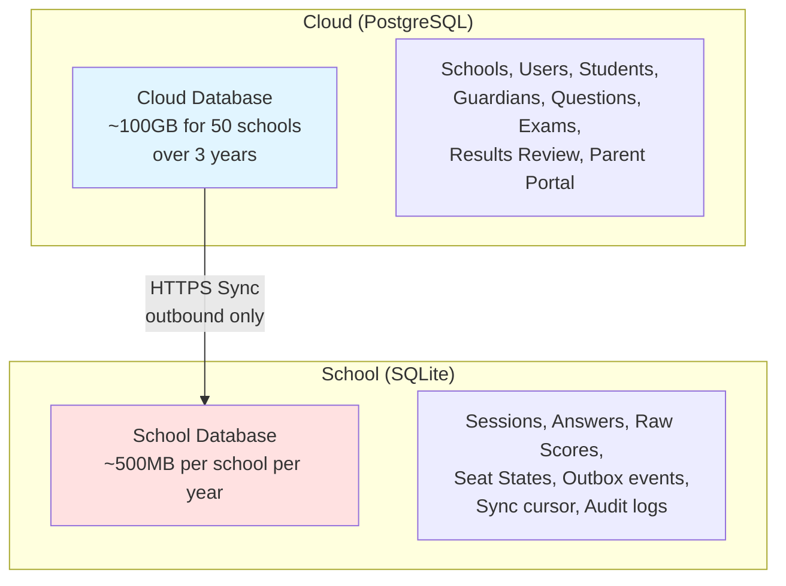

### 10.2 Data Ownership Split

| Data Type | Cloud (PostgreSQL) | School (SQLite) | Sync Direction |
|-----------|-------------------|-----------------|----------------|
| Schools, Users, Teachers | ✅ Owner | ❌ Never sent | — |
| Students, Codes | ✅ Owner | ✅ Read-only copy | Down |
| Guardians, Parents | ✅ Owner | ❌ Never sent (privacy) | — |
| Questions, Answer Keys | ✅ Owner | ✅ Encrypted in packs | Down (pack only) |
| Exams, Sittings | ✅ Owner | ✅ Read-only copy | Down |
| Sessions, Answers | ❌ Never created | ✅ Owner | Up (results only) |
| Scores (raw) | ❌ Never created | ✅ Owner | Up |
| Results (reviewed) | ✅ Owner | ❌ Not sent back | — |

### 10.3 SQLite Pragmas (Critical)

```sql
PRAGMA journal_mode = WAL;           -- Write-Ahead Logging for concurrency
PRAGMA synchronous = FULL;           -- Every committed write survives power loss
PRAGMA foreign_keys = ON;           -- Enforce referential integrity
PRAGMA busy_timeout = 5000;         -- Wait 5 seconds for locked database
PRAGMA cache_size = -64000;         -- 64MB cache for performance
PRAGMA mmap_size = 268435456;       -- 256MB memory-mapped I/O
```

### 10.4 Why SQLite on School Server

| Requirement | SQLite Feature |
|-------------|----------------|
| Zero-config | Single file, no service to crash |
| Crash safety | WAL mode with `synchronous=FULL` survives power loss |
| Fast reads | Ideal for 1 writer (server), many readers (browsers) |
| Portability | Backup = file copy; restore = file replace |
| Low resource | Runs on a school lab PC with 4GB RAM |
| Offline-first | No network dependency during exams |

### 10.5 Database Schema Comparison

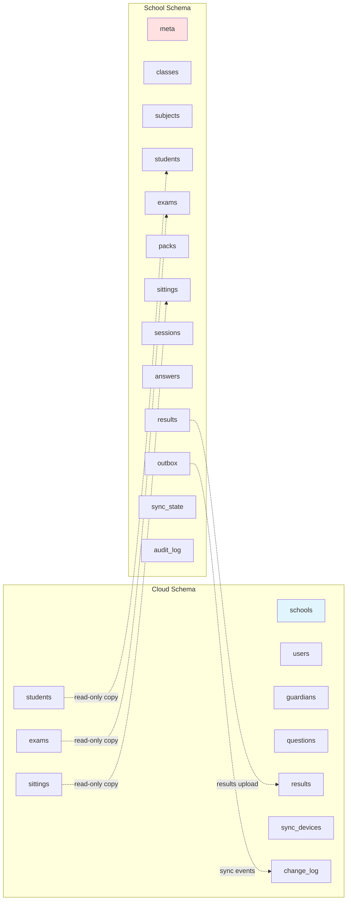

---

## 11. Sync Event Types

### 11.1 Downstream Events (Cloud → School)

| Event Type | Payload | Purpose |
|------------|---------|---------|
| `class.upsert` | Class record | Roster update |
| `class.delete` | Class ID | Remove class |
| `subject.upsert` | Subject record | Roster update |
| `subject.delete` | Subject ID | Remove subject |
| `student.upsert` | Student record + code | Roster update |
| `student.delete` | Student ID | Remove student |
| `exam.upsert` | Exam record | Schedule update |
| `exam.delete` | Exam ID | Remove exam |
| `sitting.upsert` | Sitting record | Schedule update |
| `sitting.delete` | Sitting ID | Remove sitting |
| `pack.announce` | Pack ID + version | New pack available |
| `school.settings` | Settings object | School configuration |

### 11.2 Upstream Events (School → Cloud)

| Event Type | Payload | Purpose |
|------------|---------|---------|
| `session.started` | session_id, student_id, seat, started_at | Student login |
| `session.submitted` | session_id, submitted_at, submit_reason | Exam submission |
| `session.scored` | session_id, score, max_score, pack_version | Automatic marking complete |
| `session.reset` | session_id, reason, keep_answers | Invigilator reset |
| `sitting.closed` | sitting_id, closed_at, by_whom | Exam session closed |

### 11.3 Outbox Pattern

```typescript
// Outbox table schema
interface OutboxEvent {
  id: string;           // UUIDv7
  type: string;         // Event type
  payload: string;      // JSON payload
  created_at: string;   // ISO timestamp
  sent_at?: string;     // Null until sent
  attempts: number;     // Retry counter
  last_error?: string;  // Last error message
}

// Sync agent processes outbox
class SyncAgent {
  async processOutbox(): Promise<void> {
    const unsent = await db.outbox.findMany({
      where: { sent_at: null },
      orderBy: { created_at: 'asc' },
      limit: 100
    });
    
    for (const event of unsent) {
      try {
        await this.sendToCloud(event);
        await db.outbox.update({
          where: { id: event.id },
          data: { sent_at: new Date().toISOString() }
        });
      } catch (error) {
        await db.outbox.update({
          where: { id: event.id },
          data: {
            attempts: event.attempts + 1,
            last_error: error.message
          }
        });
        // Exponential backoff before retry
        await this.delay(Math.pow(2, event.attempts) * 1000);
      }
    }
  }
}
```

---

## 12. Key Communication Protocols

### 12.1 Sync API Authentication

**Request Headers:**
```
X-Key-Id: <device_key_id>
X-Timestamp: <unix_timestamp>
X-Nonce: <random_16_bytes_base64>
X-Signature: <hmac_sha256_signature>
X-Sync-Protocol: 1
```

**Signature Calculation:**
```typescript
function calculateSignature(
  method: string,
  path: string,
  timestamp: number,
  nonce: string,
  body: Buffer,
  secret: string
): string {
  const bodyHash = crypto.createHash('sha256').update(body).digest('hex');
  
  const stringToSign = [
    'v1',
    method,
    path,
    timestamp.toString(),
    nonce,
    bodyHash
  ].join('\n');
  
  return crypto
    .createHmac('sha256', secret)
    .update(stringToSign)
    .digest('hex');
}
```

### 12.2 Pack Format

```
pack.json           - Exam metadata, version, school_id, subject, class, duration, settings
keys.enc            - Encrypted answer keys (AES-256-GCM)
assets/             - Images, media with SHA-256 hashes
signature           - Ed25519 signature over manifest
```

**Manifest Structure:**
```json
{
  "format_version": 1,
  "pack_id": "0192...",
  "exam_id": "0192...",
  "version": 1,
  "school_id": "0192...",
  "subject_id": "0192...",
  "class_ids": ["0192..."],
  "duration_min": 60,
  "shuffle_questions": true,
  "shuffle_options": true,
  "questions": [
    {
      "id": "q-001",
      "type": "single_choice",
      "stem": "What is the capital of Nigeria?",
      "options": [
        { "id": "A", "label": "A", "body": "Lagos" },
        { "id": "B", "label": "B", "body": "Abuja" },
        { "id": "C", "label": "C", "body": "Kano" },
        { "id": "D", "label": "D", "body": "Ibadan" }
      ],
      "marks": 2,
      "assets": []
    }
  ],
  "assets": [
    {
      "id": "asset-001",
      "filename": "diagram.png",
      "sha256": "abc123...",
      "size_bytes": 12345
    }
  ]
}
```

### 12.3 Student Exam API

| Endpoint | Method | Purpose |
|----------|--------|---------|
| `/api/v1/exam/login` | POST | Student code + exam key authentication |
| `/api/v1/sessions/:id` | GET | Retrieve session with saved answers |
| `/api/v1/sessions/:id/answers` | PUT | Answer save with sequence number |
| `/api/v1/exam/submit` | POST | Exam submission |

### 12.4 Console API

| Endpoint | Method | Purpose |
|----------|--------|---------|
| `/api/v1/console/login` | POST | PIN-based authentication |
| `/api/v1/console/sittings` | GET | List sittings |
| `/api/v1/console/sittings/:id/open` | POST | Open sitting, generate exam key |
| `/api/v1/console/sittings/:id/close` | POST | Close sitting |
| `/api/v1/console/sessions/:id/reset` | POST | Reset session |
| `/api/v1/console/sessions/:id/time` | POST | Add extra time |

---

## 13. Fault Tolerance & Recovery

### 13.1 Network Outage Handling

| Scenario | Behavior |
|----------|----------|
| **No internet for days** | Exams continue. Outbox grows. Parents see older data. Admin dashboard shows "last synced" |
| **Internet drops mid-upload** | Batch is retried. Idempotency keys stop duplicates |
| **Pack not loaded before exam day** | Console shows red readiness check. Cloud alerts admin 48 hours before |
| **Exam edited after freeze** | New pack version. Sessions in progress finish on version they started with |
| **School clock wrong** | Sync refuses and shows clock warning |
| **Server PC dies** | Install on spare lab PC, activate, pull roster and packs. Restore latest backup |
| **Cloud down** | Exams unaffected. Sync waits |
| **School has no internet at all** | Export results to USB drive. Import in cloud portal |

### 13.2 Server Failure Recovery

**Disaster Recovery Plan:**
1. **Spare PC:** Keep a spare PC with same specs
2. **Backup Strategy:** Nightly backups to external drive + cloud upload
3. **Recovery Time:** Under 60 minutes
4. **Recovery Steps:**
   - Install on spare PC
   - Activate with replacement code
   - Pull roster and scheduled packs from cloud
   - Restore latest backup (last 30 kept)
   - Resume exams

### 13.3 Clock Drift Handling

| Detection | Action |
|-----------|--------|
| **Sync signature failure** | Check `X-Server-Time` response header |
| **Clock offset > 2 minutes** | Console warning |
| **Clock offset > 5 minutes** | Sync rejected, manual correction required |

### 13.4 Data Loss Prevention

| Layer | Protection |
|-------|------------|
| **Browser** | IndexedDB + localStorage buffering |
| **Network** | Sequence number validation, idempotent saves |
| **Server** | SQLite `synchronous=FULL`, WAL mode |
| **Backup** | Nightly VACUUM INTO, cloud upload |
| **Sync** | Outbox pattern, never delete unsent rows |

---

## 14. Container Architecture (C4 Level 2)

### 14.1 Full Container Diagram

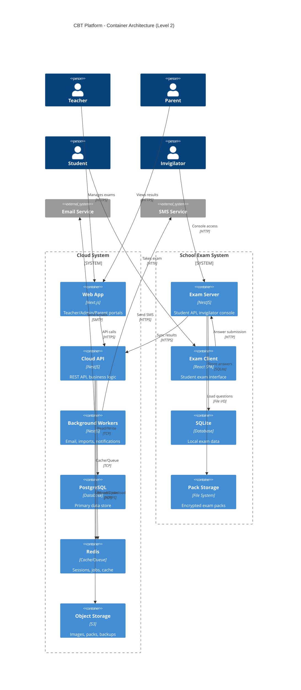

### 14.2 Cloud Container Details

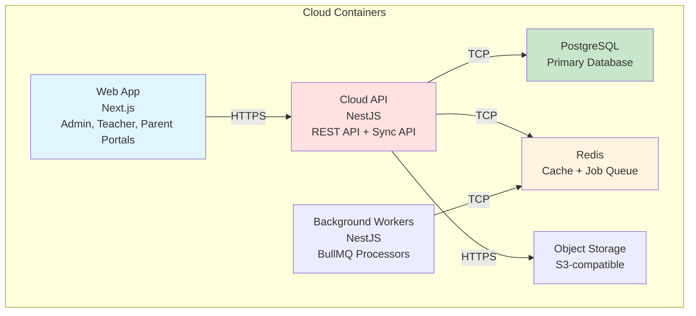

### 14.3 School Container Details

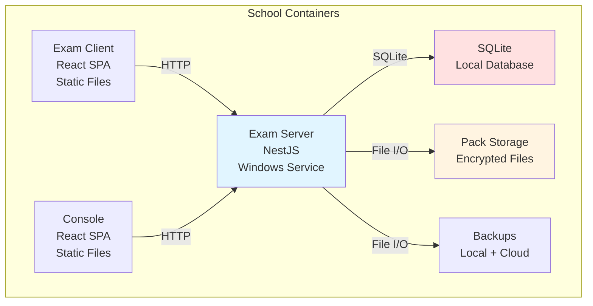

---

## 15. Deployment Architecture

### 15.1 Cloud Deployment

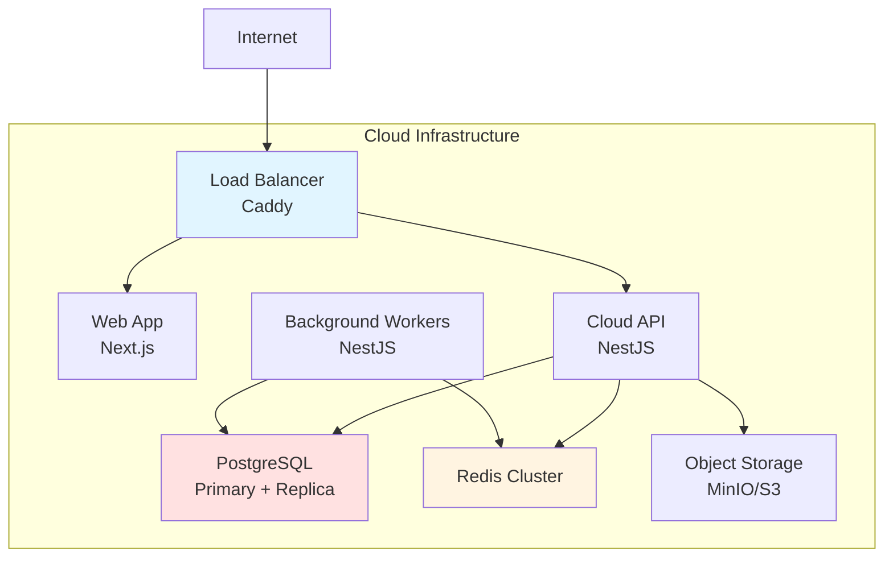

### 15.2 School Deployment

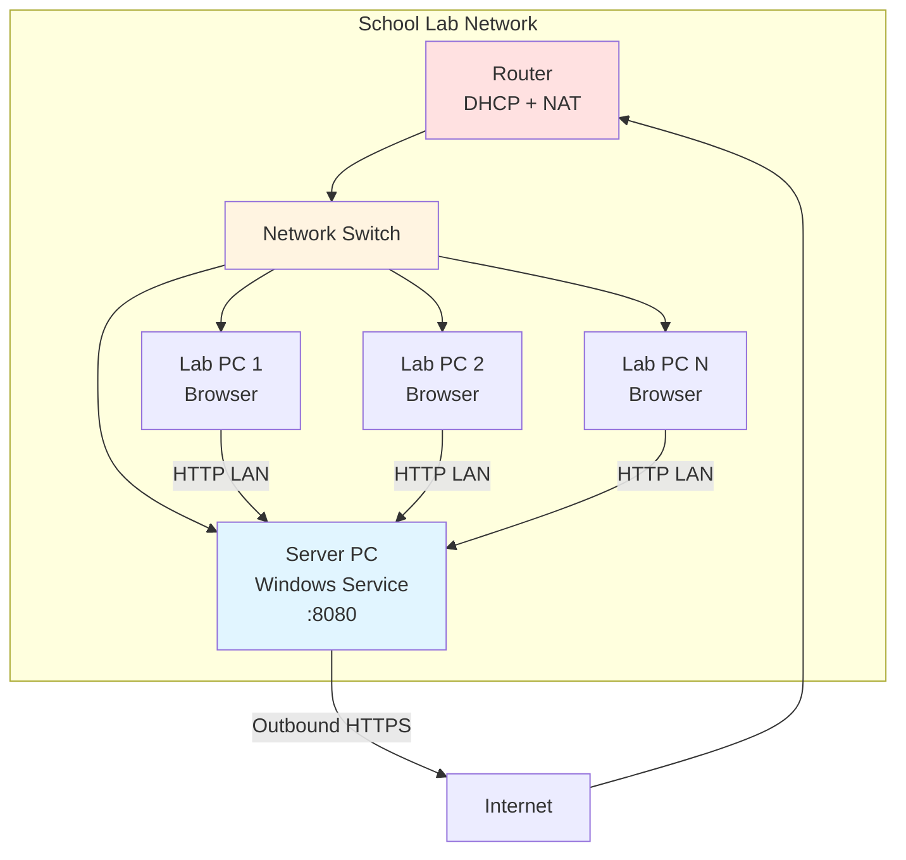

### 15.3 Non-Functional Requirements

| Area | Target | Implementation |
|------|--------|----------------|
| **Lab size** | Comfortable up to 60 concurrent. Designed and tested for 150 | Load testing with k6 |
| **Autosave latency** | Under 200 ms on lab network | SQLite WAL + sequence validation |
| **Submit and mark** | Under 2 seconds per student | Batch processing + async marking |
| **Sync size** | A day of results for 500 students uploads in minutes | Compressed batches, idempotency |
| **Data loss on server failure** | Last few seconds at most | Browser buffer + SQLite FULL |
| **Replace dead server** | Under one hour | Installer + backup restore |
| **Offline period** | Full term without internet | Outbox pattern + USB fallback |
| **Browsers** | Chrome or Edge | Chrome 109 target for Win 7/8 support |
| **Offline assets** | No CDN calls | All assets bundled locally |
| **Accessibility** | Keyboard navigation, readable fonts | WCAG 2.1 AA |
| **Languages** | English first | Translation-ready i18n files |
| **Time** | Server clock is authority | Clock check in console, sync validation |

---

## Summary

The CBT Platform is a **hybrid cloud-edge architecture** designed for reliability in challenging network conditions:

- **Cloud System:** Manages all setup, content creation, and result review. Built with NestJS, PostgreSQL, Redis, and Next.js.
- **School Exam Server:** Runs offline as a Windows service, managing live exam sessions with SQLite. Built with NestJS and better-sqlite3.
- **Exam Client:** Thin web interface served from school server, works completely offline during exams. Built with React and Vite.
- **Communication:** Unidirectional sync from cloud to school (roster/packs), upstream only for results. School initiates all sync (no NAT traversal needed).
- **Data Ownership:** Clear separation prevents conflicts. Cloud owns setup/questions, school owns sessions/answers.
- **Fault Tolerance:** Multiple layers of protection: browser buffering, SQLite FULL sync, outbox pattern, backups, USB fallback.
- **Scalability:** Supports 200+ concurrent students per school server, scales horizontally in cloud for multi-tenant deployment.

This architecture ensures exams can run to completion even with complete internet failure, while still providing cloud-based management and parent access when connectivity is available.
