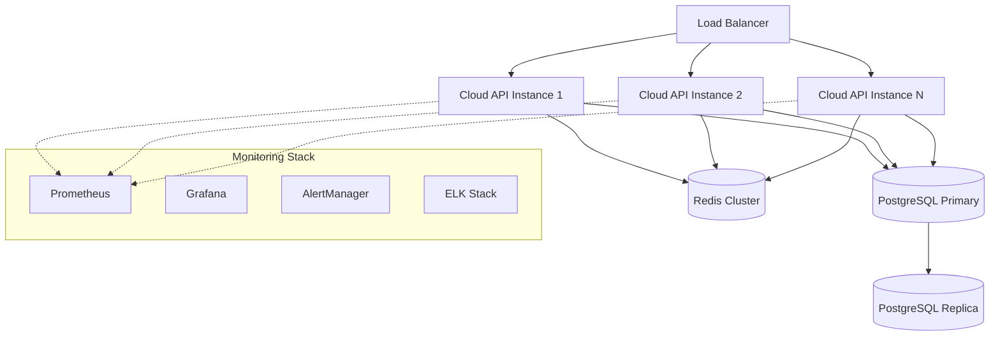

# CBT Platform — Phase 10: Monitoring & Production

**Version:** 1.0  
**Date:** October 14, 2026  
**Phase Duration:** 5-7 days  
**Team Size:** 2-3 developers (1 DevOps specialist)  
**Risk Level:** Medium  
**Dependencies:** Phase 9 (Results & Analytics) complete  

---

## Table of Contents

1. [Phase Overview](#1-phase-overview)
2. [Phase Story](#2-phase-story)
3. [Implementation Prompt](#3-implementation-prompt)
4. [Independent Verification Prompt](#4-independent-verification-prompt)

---

## 1. Phase Overview

### 1.1 Phase Goals

Phase 10 implements **production-ready monitoring, deployment, and operational tooling** to ensure the CBT Platform runs reliably at scale with comprehensive observability and automated incident response.

### 1.2 Key Deliverables

| Deliverable | Description | Success Criteria |
|-------------|-------------|------------------|
| **Application Monitoring** | Performance metrics and health dashboards | Complete system visibility |
| **Logging & Observability** | Centralized logging with search and analysis | Fast issue diagnosis and resolution |
| **Alerting System** | Automated incident detection and notification | Proactive issue identification |
| **Deployment Pipeline** | Automated CI/CD with zero-downtime deployments | Safe, reliable releases |
| **Backup & Recovery** | Automated backups with tested restore procedures | Data protection and business continuity |
| **Performance Optimization** | Load balancing, caching, and scaling strategies | Handles peak exam loads |
| **Security Monitoring** | Intrusion detection and security event monitoring | Comprehensive security posture |

### 1.3 Production Architecture

### 1.4 Success Criteria

✅ **99.9% uptime during exam periods**  
✅ **Complete observability into system performance**  
✅ **Automated incident detection and response**  
✅ **Zero-downtime deployments**  
✅ **Comprehensive backup and disaster recovery**  
✅ **Performance scales to peak examination loads**  

---

## 2. Phase Story

### 2.1 The Production Challenge

Moving from development to production means transitioning from "works on my machine" to "works for thousands of students during high-stakes exams." Phase 10 builds the operational excellence required for mission-critical educational infrastructure.

### 2.2 What We're Building

**The Observability Platform**  
Comprehensive monitoring that provides real-time visibility into every aspect of system performance, from database queries to user experience metrics.

**The Automated Operations System**  
Smart automation that handles routine operational tasks, detects and responds to incidents, and provides operators with the information they need for rapid resolution.

**The Deployment Infrastructure**  
Production-grade CI/CD pipeline with automated testing, staged rollouts, and instant rollback capabilities that ensure safe, reliable releases.

**The Resilience Framework**  
Backup systems, disaster recovery procedures, and redundancy strategies that ensure the platform remains available even during hardware failures or natural disasters.

### 2.3 Why This Phase Matters

**Reliability**: Students taking high-stakes exams cannot tolerate system failures—production monitoring ensures issues are detected and resolved before they impact users.

**Performance**: Exam periods create massive load spikes that must be handled gracefully without degrading user experience.

**Security**: Production systems face constant security threats that require automated detection and response capabilities.

**Compliance**: Educational institutions require comprehensive audit trails, backup procedures, and security controls for regulatory compliance.

### 2.4 Phase Success Story

When Phase 10 is complete:

**For Operations Teams:**
- Complete visibility into system health and performance
- Automated alerting for all critical issues
- Streamlined deployment and rollback procedures
- Comprehensive disaster recovery capabilities

**For Development Teams:**
- Fast feedback on production performance
- Detailed error tracking and debugging information
- Safe deployment processes with automatic rollbacks
- Performance insights for optimization

**For Stakeholders:**
- Reliable, consistent system availability
- Fast issue resolution when problems occur
- Confidence in data protection and backup procedures
- Transparent reporting on system performance and uptime

**For Students and Teachers:**
- Consistently fast, reliable exam experiences
- Minimal system disruptions or maintenance windows
- Quick recovery from any technical issues
- Seamless experience during peak usage periods