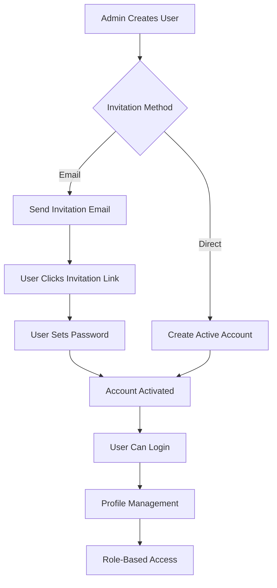

# CBT Platform — Phase 4: User Management

**Version:** 1.0  
**Date:** October 14, 2026  
**Phase Duration:** 5-7 days  
**Team Size:** 2-3 developers  
**Risk Level:** Low  
**Dependencies:** Phase 2 (Authentication) + Phase 3 (Data Layer) complete  

---

## Table of Contents

1. [Phase Overview](#1-phase-overview)
2. [Phase Story](#2-phase-story)
3. [Implementation Prompt](#3-implementation-prompt)
4. [Independent Verification Prompt](#4-independent-verification-prompt)

---

## 1. Phase Overview

### 1.1 Phase Goals

Phase 4 implements **comprehensive user management** for the CBT Platform, including user CRUD operations, invitation workflows, role assignments, and profile management across all user types.

### 1.2 Key Deliverables

| Deliverable | Description | Success Criteria |
|-------------|-------------|------------------|
| **User CRUD Operations** | Create, read, update, delete users | All operations work with proper authorization |
| **Invitation System** | Email-based user invitations with activation | Invitations sent and activated successfully |
| **Role Management** | Assign and modify user roles | Role changes update permissions correctly |
| **Profile Management** | User profile editing and preferences | Users can update their own information |
| **Bulk Operations** | Import/export users, bulk invitations | Handle large user datasets efficiently |
| **Student Code Management** | Generate and assign student codes | Codes work for exam access |

### 1.3 User Lifecycle

### 1.4 Success Criteria

✅ **All user types can be created and managed**  
✅ **Invitation workflow works reliably**  
✅ **Role assignments update permissions correctly**  
✅ **Bulk operations handle large datasets**  
✅ **Student codes integrate with exam access**  
✅ **Profile management respects authorization rules**  

---

## 2. Phase Story

### 2.1 The User Management Challenge

The CBT Platform serves diverse user types—from platform owners managing multiple schools to students taking individual exams. Each user type has different needs, permissions, and workflows that must be managed efficiently and securely.

### 2.2 What We're Building

**The User Administration System**  
Comprehensive tools for administrators to create, invite, and manage users across different roles and schools, with proper authorization boundaries and audit trails.

**The Invitation Workflow**  
Secure, email-based invitation system that allows administrators to onboard users smoothly while maintaining security through email verification and password setup.

**The Profile Management Interface**  
Self-service tools for users to manage their own profiles, preferences, and settings while respecting role-based access controls.

**The Student Identity System**  
Special handling for student users, including student code generation, assignment tracking, and exam access integration.

### 2.3 Why This Phase Matters

**Scalability**: Schools need to onboard hundreds or thousands of students efficiently, requiring robust bulk operations and streamlined workflows.

**Security**: User management operations must respect authorization boundaries—school admins cannot access other schools' users, teachers cannot modify unrelated accounts.

**Usability**: The invitation and profile management systems must be intuitive enough for non-technical administrators and users to operate independently.

**Integration**: User management integrates with authentication (Phase 2) and enables question banks and exams (Phases 5-6) by establishing proper role and permission foundations.

### 2.4 Phase Success Story

When Phase 4 is complete:

**For School Administrators:**
- Efficiently onboard entire classes of students and teachers
- Manage user roles and permissions with confidence
- Track invitation status and user activation
- Bulk import users from existing school systems

**For Teachers:**
- Simple profile management and preference settings
- Clear visibility of assigned classes and subjects
- Easy password and contact information updates

**For Students:**
- Receive and activate accounts through parent/guardian email
- Simple profile access for basic information updates
- Student codes work seamlessly for exam access

**For Platform Owners:**
- Complete oversight of user management across all schools
- Audit trails for compliance and security
- Efficient onboarding of new schools and administrators