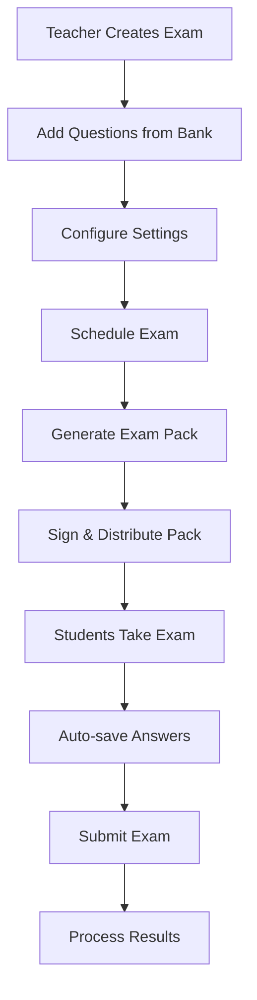

# CBT Platform — Phase 6: Exam Engine

**Version:** 1.0  
**Date:** October 14, 2026  
**Phase Duration:** 10-12 days  
**Team Size:** 4-5 developers  
**Risk Level:** High  
**Dependencies:** Phase 5 (Question Bank) complete  

---

## Table of Contents

1. [Phase Overview](#1-phase-overview)
2. [Phase Story](#2-phase-story)
3. [Implementation Prompt](#3-implementation-prompt)
4. [Independent Verification Prompt](#4-independent-verification-prompt)

---

## 1. Phase Overview

### 1.1 Phase Goals

Phase 6 implements the **core exam engine** - the heart of the CBT Platform that creates, packages, delivers, and manages computer-based examinations. This is the most complex and critical phase, where all previous work culminates into actual exam functionality.

### 1.2 Key Deliverables

| Deliverable | Description | Success Criteria |
|-------------|-------------|------------------|
| **Exam Builder** | GUI and API for creating exams from question bank | Teachers can create complete exams |
| **Pack Generator** | Creates signed, portable exam packages | Deterministic packs with proper signatures |
| **Exam Scheduler** | Manages exam timing and student assignments | Scheduled exams activate automatically |
| **Student Exam Interface** | Exam delivery UI with auto-save | Students can take exams reliably |
| **Shuffling Engine** | Deterministic question/option randomization | Same seed = same order always |
| **Answer Collection** | Secure answer storage and submission | No data loss, tamper-proof storage |
| **Session Management** | Exam session state and recovery | Sessions survive network interruptions |

### 1.3 Exam Lifecycle



### 1.4 Success Criteria

✅ **Teachers can create and schedule exams efficiently**  
✅ **Exam packs are deterministic and verifiable**  
✅ **Students can take exams without technical issues**  
✅ **Answer auto-save prevents data loss**  
✅ **Shuffling maintains exam integrity**  
✅ **System handles concurrent exam sessions**  

---

## 2. Phase Story

### 2.1 The Exam Engine Challenge

The exam engine is where theoretical architecture meets practical reality. This is where:
- **Teachers** need intuitive tools to create meaningful assessments
- **Students** need reliable, distraction-free exam experiences  
- **Administrators** need confidence in system integrity
- **Parents** need assurance of fair, accurate assessment

### 2.2 What We're Building

**The Exam Creation Workshop**  
A comprehensive exam builder where teachers can select questions, configure timing, set up shuffling, and schedule delivery. The interface must be intuitive enough for non-technical teachers while powerful enough for complex assessment scenarios.

**The Pack Generation Engine**  
The mathematical heart that takes an exam definition and creates a portable, signed package containing all questions, media assets, and metadata. These packs must be deterministic—the same exam configuration always produces the same pack.

**The Student Exam Environment**  
A focused, reliable interface where students answer questions with confidence. Features include auto-save, progress tracking, time management, and graceful handling of network issues. The experience must be stress-free and accessible.

**The Shuffling & Randomization System**  
Using deterministic algorithms to ensure fair question distribution while maintaining exam security. Every student gets a unique question order, but the system remains auditable and reproducible.

### 2.3 Why This Phase Matters

**Exam Integrity**: Proper shuffling and security prevents cheating while ensuring fair assessment for all students.

**Reliability**: Students taking high-stakes exams cannot afford system failures. The exam engine must be bulletproof.

**Usability**: Complex functionality must be wrapped in simple, intuitive interfaces that teachers and students can use without training.

**Scalability**: The system must handle hundreds of concurrent exam sessions during peak testing periods.

### 2.4 Phase Success Story

When Phase 6 is complete:

**For Teachers:**
- Create comprehensive exams in minutes, not hours
- Confidence that technical issues won't disrupt assessments
- Flexible scheduling and configuration options
- Clear visibility into exam progress and completion

**For Students:**
- Smooth, distraction-free exam experience
- Automatic answer saving prevents data loss
- Clear navigation and progress indicators
- Consistent experience across different devices

**For Administrators:**
- Complete oversight of exam scheduling and delivery
- Audit trails for compliance and security
- Performance monitoring and issue resolution
- Scalable system supporting school-wide testing

**For the Platform:**
- Robust exam delivery supporting complex scenarios
- Deterministic, auditable exam generation
- High availability during critical testing periods
- Foundation for advanced features like adaptive testing
---

## 3. Implementation Prompt

```markdown
## IMPLEMENTATION PROMPT: Phase 6 - Exam Engine

**CONTEXT:** You are implementing the core exam engine for the CBT Platform. Previous phases have established authentication, user management, and question bank systems. This phase creates the complete exam lifecycle from creation to student delivery.

**OBJECTIVE:** Build a reliable, scalable exam engine that supports concurrent exam sessions, deterministic shuffling, and robust answer collection with zero data loss tolerance.

---

### TASK 1: Exam Builder & Management

**Create comprehensive exam creation and management system:**

**Exam Builder Architecture:**
```typescript
// apps/cloud-api/src/modules/exams/
├── exam.module.ts              # Exam module
├── exam.controller.ts          # Exam CRUD endpoints  
├── exam.service.ts             # Core exam business logic
├── exam-builder.service.ts     # Exam creation workflow
├── exam-scheduler.service.ts   # Scheduling and timing
├── exam-pack.service.ts        # Pack generation
└── dto/
    ├── create-exam.dto.ts      # Exam creation request
    ├── update-exam.dto.ts      # Exam modification
    ├── schedule-exam.dto.ts    # Scheduling configuration
    └── exam-settings.dto.ts    # Exam configuration options
```

**Requirements:**

1. **Exam Creation Service:**
   ```typescript
   export class ExamBuilderService {
     async createExam(teacherId: string, examData: CreateExamDto): Promise<Exam> {
       // 1. Validate teacher permissions for subjects
       // 2. Validate question selections
       // 3. Create exam with default settings
       // 4. Generate unique exam identifier
     }
     
     async addQuestions(examId: string, questionSelection: QuestionSelection): Promise<void> {
       // Support multiple selection methods:
       // - Individual question IDs
       // - Filter criteria (topic, difficulty, type)
       // - Random selection from criteria
       // - Question bank imports
     }
     
     async configureSettings(examId: string, settings: ExamSettings): Promise<void> {
       // Configure:
       // - Time limits (overall and per-question)
       // - Shuffling options (questions, options, both)
       // - Navigation rules (can skip, must answer all)
       // - Submission rules (auto-submit, manual only)
       // - Calculator and reference material access
     }
   }
   ```

2. **Exam Scheduling System:**
   ```typescript
   export class ExamSchedulerService {
     async scheduleExam(examId: string, schedule: ExamSchedule): Promise<ExamSitting> {
       // Create sitting with:
       // - Start and end times
       // - Student assignments
       // - Room/location assignments
       // - Proctor assignments
       // - Special accommodations
     }
     
     async generateStudentCodes(sittingId: string): Promise<StudentCodeAssignment[]> {
       // Generate unique student codes for this sitting
       // Codes must be valid for this specific exam only
     }
     
     async activateExam(sittingId: string): Promise<void> {
       // Make exam available for students
       // Generate exam keys
       // Create exam sessions
     }
   }
   ```

3. **Exam Configuration Options:**
   ```typescript
   interface ExamSettings {
     // Timing configuration
     timeLimit?: number;          // Minutes, null for unlimited
     questionTimeLimit?: number;  // Per-question limit
     warningThresholds: number[]; // [10, 5, 1] minutes remaining
     
     // Navigation configuration
     allowSkipping: boolean;      // Can skip questions
     allowBackNavigation: boolean; // Can go back to previous questions
     showProgress: boolean;       // Show question X of Y
     
     // Shuffling configuration
     shuffleQuestions: boolean;   // Randomize question order
     shuffleOptions: boolean;     // Randomize answer options
     shuffleSeed?: string;        // Custom seed or auto-generate
     
     // Submission configuration
     autoSubmitOnTimeout: boolean; // Submit when time expires
     allowEarlySubmission: boolean; // Can submit before time limit
     requireAllAnswered: boolean;  // Must answer all questions
     
     // Access configuration
     allowCalculator: boolean;    // Built-in calculator access
     allowReferenceMaterial: string[]; // URLs to reference documents
     fullScreenMode: boolean;     // Lock to fullscreen during exam
   }
   ```

**Files to Create:**
- apps/cloud-api/src/modules/exams/exam.service.ts
- apps/cloud-api/src/modules/exams/exam-builder.service.ts
- apps/cloud-api/src/modules/exams/exam-scheduler.service.ts
- apps/cloud-api/src/modules/exams/dto/create-exam.dto.ts
- apps/cloud-api/src/modules/exams/entities/exam.entity.ts

---

### TASK 2: Deterministic Pack Generation

**Implement exam pack creation with cryptographic signatures:**

**CRITICAL REQUIREMENT: Pack generation must be 100% deterministic**
- Same exam configuration + same timestamp = identical pack
- Packs must be verifiable and tamper-proof
- All assets (images, audio) included in pack

```typescript
export class ExamPackService {
  async generatePack(examId: string, sittingId: string): Promise<ExamPack> {
    // 1. Gather all exam data and assets
    const examData = await this.gatherExamData(examId);
    const assets = await this.gatherAssets(examData.questions);
    
    // 2. Create deterministic manifest
    const manifest = this.createManifest(examData, assets, sittingId);
    
    // 3. Sign manifest with school's private key
    const signature = await this.signManifest(manifest);
    
    // 4. Package everything into distributable format
    const pack = this.createPackage(manifest, assets, signature);
    
    return pack;
  }
  
  private createManifest(examData: ExamData, assets: AssetMap, sittingId: string): PackManifest {
    return {
      version: "1.0",
      examId: examData.id,
      sittingId: sittingId,
      createdAt: new Date().toISOString(),
      
      // Exam metadata
      exam: {
        title: examData.title,
        description: examData.description,
        timeLimit: examData.settings.timeLimit,
        questionCount: examData.questions.length,
        settings: examData.settings
      },
      
      // Question data (without answer keys)
      questions: examData.questions.map(q => ({
        id: q.id,
        type: q.type,
        content: q.content,
        options: q.options,
        media: q.mediaFiles,
        marks: q.marks
      })),
      
      // Asset manifest
      assets: Object.keys(assets).map(key => ({
        id: key,
        filename: assets[key].filename,
        mimeType: assets[key].mimeType,
        size: assets[key].size,
        checksum: assets[key].checksum
      })),
      
      // Security data
      checksum: this.calculateManifestChecksum(examData, assets)
    };
  }
}
```

**Pack Structure:**
```
exam-pack-{sitting-id}.zip
├── manifest.json           # Exam metadata and structure
├── manifest.sig           # Digital signature  
├── questions/             # Question data files
│   ├── question-1.json
│   ├── question-2.json
│   └── ...
├── assets/               # Media assets
│   ├── images/
│   ├── audio/
│   └── documents/
└── keys.encrypted        # Answer keys (encrypted)
```

**Files to Create:**
- apps/cloud-api/src/modules/exams/exam-pack.service.ts
- apps/cloud-api/src/modules/exams/pack-builder.service.ts
- apps/cloud-api/src/modules/exams/pack-signer.service.ts
- packages/exam-core/src/packs/pack-validator.ts

---

### TASK 3: Student Exam Interface

**Build the student-facing exam delivery system:**

**Exam Session Management:**
```typescript
export class ExamSessionService {
  async startExamSession(studentCode: string, examKey: string): Promise<ExamSession> {
    // 1. Validate student code and exam key
    // 2. Check exam availability and timing
    // 3. Generate deterministic question order for this student
    // 4. Create session with auto-save capability
    // 5. Initialize answer tracking
  }
  
  async getNextQuestion(sessionId: string, direction: 'next' | 'previous'): Promise<QuestionWithState> {
    // Return question with:
    // - Current answer (if any)
    // - Navigation state (can go back/forward)
    // - Time remaining
    // - Progress indicator
  }
  
  async saveAnswer(sessionId: string, questionId: string, answer: Answer): Promise<void> {
    // 1. Validate answer format
    // 2. Store with timestamp
    // 3. Update session progress
    // 4. Trigger auto-save (every 30 seconds or on answer change)
  }
  
  async submitExam(sessionId: string, isForced: boolean = false): Promise<SubmissionResult> {
    // 1. Validate all required questions answered (if configured)
    // 2. Final save of all answers
    // 3. Mark session as completed
    // 4. Generate submission receipt
    // 5. Trigger result calculation
  }
}
```

**Auto-Save Implementation:**
```typescript
export class AutoSaveService {
  private saveQueues = new Map<string, AnswerQueue>();
  
  async scheduleAnswerSave(sessionId: string, questionId: string, answer: Answer): Promise<void> {
    // Add to save queue with debouncing (save after 2 seconds of no changes)
    // Implement exponential backoff for failed saves
    // Maintain offline queue for network interruptions
  }
  
  async flushPendingSaves(sessionId: string): Promise<SaveResult> {
    // Force save of all pending answers
    // Return success/failure status for each answer
  }
}
```

**Performance Requirements:**
- Answer auto-save: <2 seconds after change
- Question navigation: <500ms response time
- Session recovery: <5 seconds after network restoration
- Concurrent sessions: Support 200 students per server

**Files to Create:**
- apps/school-server/src/modules/exam-session/session.service.ts
- apps/school-server/src/modules/exam-session/auto-save.service.ts
- apps/school-server/src/modules/exam-session/navigation.service.ts
- apps/exam-client/src/components/ExamInterface.tsx
```

---

## 4. Independent Verification Prompt

```markdown
## VERIFICATION PROMPT: Phase 6 Exam Engine Complete

**OBJECTIVE:** Verify that the exam engine correctly implements all exam lifecycle functionality with reliability, security, and performance requirements met.

**CRITICAL FOCUS AREAS:**
- Deterministic pack generation (same inputs = same outputs)
- Answer auto-save reliability (zero data loss tolerance)
- Concurrent session handling (200+ simultaneous students)
- Exam integrity and security throughout lifecycle

---

### SECTION 1: Exam Creation & Management Verification

- [ ] **Exam Builder Testing**:
  ```bash
  # Create exam with question selection
  curl -X POST /exams -H "Authorization: Bearer $TEACHER_TOKEN" -d '{
    "title": "Mathematics Final",
    "subjectId": "math-101",
    "questionIds": ["q1", "q2", "q3"]
  }'
  
  # Verify exam created correctly
  # Test question validation and permission checks
  # Test exam configuration options
  ```

- [ ] **Scheduling System Testing**:
  ```bash
  # Schedule exam for specific time and students
  curl -X POST /exams/$EXAM_ID/schedule -d '{
    "startTime": "2026-10-15T09:00:00Z",
    "endTime": "2026-10-15T11:00:00Z", 
    "studentIds": ["s1", "s2", "s3"]
  }'
  
  # Verify student codes generated
  # Test activation at scheduled time
  ```

**Expected Results:**
- Teachers can create exams efficiently
- Question selection validates permissions
- Scheduling works with proper timing
- Student assignments are correct

---

### SECTION 2: Pack Generation Verification

**CRITICAL: Test deterministic pack generation:**

- [ ] **Deterministic Testing**:
  ```bash
  # Generate same pack twice
  PACK1=$(curl -X POST /exams/$EXAM_ID/generate-pack)
  PACK2=$(curl -X POST /exams/$EXAM_ID/generate-pack)
  
  # Verify identical results
  diff $PACK1 $PACK2 # Should show no differences
  
  # Test with different timestamps but same config
  # Should produce different packs due to timestamp
  ```

- [ ] **Pack Structure Verification**:
  ```bash
  # Extract and verify pack structure
  unzip exam-pack-123.zip
  
  # Verify manifest.json contains all required fields
  # Verify all assets are included
  # Verify signature is valid
  # Test pack loading on school server
  ```

**Expected Results:**
- Identical configs produce identical packs
- All required assets included
- Digital signatures verify correctly
- Packs load successfully on school servers

---

### SECTION 3: Student Exam Experience Verification

- [ ] **Session Management Testing**:
  ```bash
  # Start exam session
  curl -X POST /exam-sessions/start -d '{
    "studentCode": "GRA-7K2M9QXDG",
    "examKey": "123456"
  }'
  
  # Test question navigation
  # Test answer saving and retrieval
  # Test session recovery after network interruption
  ```

- [ ] **Auto-Save Reliability Testing**:
  ```typescript
  // Simulate rapid answer changes
  for (let i = 0; i < 100; i++) {
    await saveAnswer(sessionId, questionId, `Answer ${i}`);
    await sleep(50); // 50ms between changes
  }
  
  // Verify final answer is correct
  // Test network interruption during save
  // Test recovery of unsaved answers
  ```

- [ ] **Concurrent Session Testing**:
  ```bash
  # Start 200 concurrent exam sessions
  # Verify all sessions work correctly
  # Test answer saving under load
  # Measure response times
  ```

**Expected Results:**
- Sessions start reliably for valid credentials
- Auto-save never loses student answers
- System handles concurrent load gracefully
- Performance targets met under stress

---

### VERIFICATION COMPLETION CRITERIA

**Phase 6 is COMPLETE when:**
✅ Pack generation is 100% deterministic  
✅ Zero data loss in answer auto-save system  
✅ 200+ concurrent sessions supported  
✅ All exam workflows function end-to-end  
✅ Performance targets met under load  
✅ Security controls prevent exam compromise  

**Critical Success Metrics:**
- Pack generation: Same config = Same pack (100% deterministic)
- Answer reliability: Zero lost answers in stress testing
- Performance: <500ms question navigation, <2s auto-save
- Concurrency: 200 simultaneous students without degradation
- Uptime: >99.9% availability during exam periods

---

**Verification Sign-off:**
- [ ] Deterministic pack generation verified: Yes / No
- [ ] Auto-save reliability tested: Zero data loss / Issues found
- [ ] Concurrent load tested: 200+ sessions / Lower capacity
- [ ] Performance targets met: Yes / No  
- [ ] Ready for Phase 7: Yes / No
```