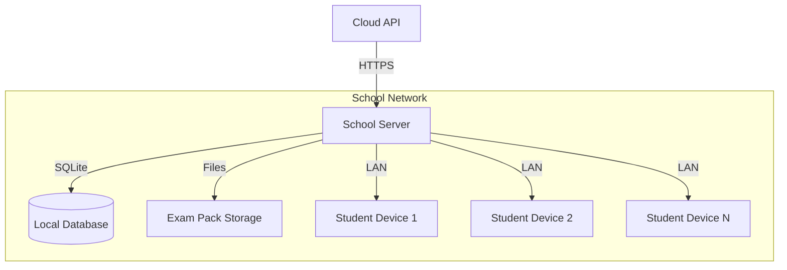

# CBT Platform — Phase 7: School Server

**Version:** 1.0  
**Date:** October 14, 2026  
**Phase Duration:** 8-10 days  
**Team Size:** 2-3 developers  
**Risk Level:** Medium  
**Dependencies:** Phase 6 (Exam Engine) complete  

---

## Table of Contents

1. [Phase Overview](#1-phase-overview)
2. [Phase Story](#2-phase-story)
3. [Implementation Prompt](#3-implementation-prompt)
4. [Independent Verification Prompt](#4-independent-verification-prompt)

---

## 1. Phase Overview

### 1.1 Phase Goals

Phase 7 implements the **school server system** - a local NestJS application that runs on school networks to deliver exams offline, ensuring reliable exam delivery even with poor internet connectivity or during network outages.

### 1.2 Key Deliverables

| Deliverable | Description | Success Criteria |
|-------------|-------------|------------------|
| **Local Exam Server** | NestJS app for offline exam delivery | Serves exams without internet |
| **Pack Distribution** | Download and cache exam packs | Packs sync reliably from cloud |
| **Student Authentication** | Local student code validation | Students can login offline |
| **Answer Collection** | Local answer storage and sync | Zero answer loss guarantee |
| **Network Resilience** | Graceful online/offline handling | Seamless transitions |
| **Administration Panel** | Local management interface | School staff can monitor exams |

### 1.3 Architecture Overview

### 1.4 Success Criteria

✅ **School server runs reliably on Windows/Linux**  
✅ **Exams work completely offline once downloaded**  
✅ **200+ concurrent students supported per server**  
✅ **Network interruptions don't affect active exams**  
✅ **Answer synchronization is bulletproof**  
✅ **Setup and maintenance require minimal technical skill**  

---

## 2. Phase Story

### 2.1 The Offline Challenge

Many schools face unreliable internet connectivity, especially in rural areas or developing regions. High-stakes exams cannot depend on internet stability—students deserve reliable, consistent exam experiences regardless of network conditions.

### 2.2 What We're Building

**The Local Exam Hub**  
A robust server application that runs on school hardware, creating a local network bubble where exams function perfectly regardless of external internet connectivity.

**The Sync Engine**  
Intelligent synchronization that downloads exam packs when connectivity is good and uploads results when possible, with sophisticated conflict resolution and retry mechanisms.

**The Resilience Layer**  
Network-aware functionality that gracefully handles connection drops, automatically switches between online and offline modes, and ensures no student work is ever lost.

**The School Administration Dashboard**  
Local web interface that allows school IT staff to monitor exam progress, manage student sessions, and troubleshoot issues without requiring cloud connectivity.

### 2.3 Why This Phase Matters

**Reliability**: Eliminates internet connectivity as a single point of failure for exam delivery, ensuring consistent exam experiences.

**Performance**: Local delivery provides faster response times and eliminates bandwidth limitations for media-rich questions.

**Compliance**: Meets requirements for secure, controlled exam environments in regions with strict data sovereignty rules.

**Accessibility**: Enables CBT deployment in schools with limited infrastructure while maintaining the same feature set as cloud-connected schools.

### 2.4 Phase Success Story

When Phase 7 is complete:

**For Students:**
- Consistent, fast exam experience regardless of internet quality
- No interruptions due to network issues
- Same reliable interface as cloud-connected exams

**For Teachers:**
- Confidence that technical issues won't disrupt assessments
- Local monitoring and support capabilities
- Faster exam delivery due to local hosting

**For School IT Staff:**
- Simple installation and maintenance procedures
- Clear monitoring dashboards for exam status
- Automatic handling of network connectivity changes

**For Administrators:**
- Expanded deployment options including low-connectivity schools
- Compliance with local data protection requirements
- Reduced dependency on external infrastructure