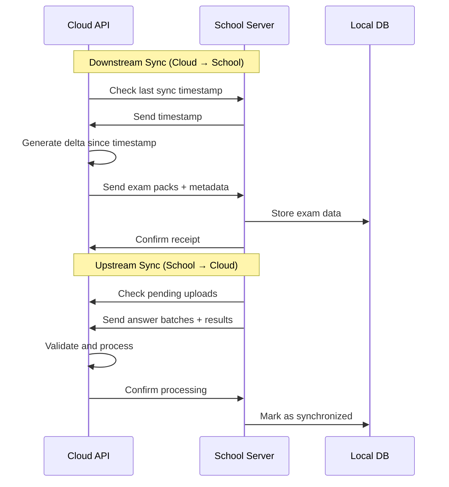

# CBT Platform — Phase 8: Sync System

**Version:** 1.0  
**Date:** October 14, 2026  
**Phase Duration:** 10-12 days  
**Team Size:** 3-4 developers  
**Risk Level:** High  
**Dependencies:** Phase 7 (School Server) complete  

---

## Table of Contents

1. [Phase Overview](#1-phase-overview)
2. [Phase Story](#2-phase-story)
3. [Implementation Prompt](#3-implementation-prompt)
4. [Independent Verification Prompt](#4-independent-verification-prompt)

---

## 1. Phase Overview

### 1.1 Phase Goals

Phase 8 implements the **bidirectional synchronization system** between cloud API and school servers, ensuring data consistency while handling network interruptions, conflicts, and large-scale data transfers.

### 1.2 Key Deliverables

| Deliverable | Description | Success Criteria |
|-------------|-------------|------------------|
| **Sync Engine** | Bidirectional data synchronization | Data stays consistent across systems |
| **Conflict Resolution** | Handle concurrent modifications | No data loss, clear resolution rules |
| **Batch Processing** | Efficient large dataset transfers | Handles thousands of records |
| **Network Resilience** | Retry and recovery mechanisms | Sync completes despite interruptions |
| **Delta Synchronization** | Only sync changed data | Minimizes bandwidth usage |
| **Monitoring Dashboard** | Sync status and health monitoring | Clear visibility into sync operations |

### 1.3 Synchronization Flow

### 1.4 Success Criteria

✅ **Data remains consistent across cloud and school servers**  
✅ **Sync handles network interruptions gracefully**  
✅ **Conflicts resolved without data loss**  
✅ **Large datasets sync efficiently**  
✅ **Real-time monitoring shows sync health**  
✅ **Performance scales to hundreds of schools**  

---

## 2. Phase Story

### 2.1 The Synchronization Challenge

The CBT Platform operates across two distinct environments: the connected cloud where exams are created and results are analyzed, and disconnected school servers where exams are delivered. Keeping these synchronized while handling network failures, concurrent modifications, and large data volumes requires sophisticated engineering.

### 2.2 What We're Building

**The Intelligent Sync Engine**  
Smart synchronization that understands data relationships, minimizes bandwidth usage through delta sync, and handles partial transfers gracefully.

**The Conflict Resolution System**  
Robust handling of concurrent modifications with clear, predictable resolution rules that preserve data integrity and provide audit trails for any conflicts.

**The Network-Resilient Transport**  
Sophisticated retry mechanisms, exponential backoff, and partial transfer recovery that ensure sync operations complete even over unreliable connections.

**The Monitoring and Observability Layer**  
Comprehensive visibility into sync operations, performance metrics, and health status that enables proactive issue resolution.

### 2.3 Why This Phase Matters

**Data Integrity**: The sync system is the critical link that ensures exam results reach the cloud for processing while maintaining perfect data consistency.

**Operational Reliability**: Schools depend on the sync system to receive new exams and upload completed results—failures directly impact educational operations.

**Scalability**: As the platform grows to hundreds of schools, the sync system must handle massive aggregate data volumes efficiently.

**Network Optimization**: Many schools have limited bandwidth, requiring intelligent sync strategies that minimize data transfer without compromising functionality.

### 2.4 Phase Success Story

When Phase 8 is complete:

**For School Administrators:**
- New exams appear automatically on school servers
- Student results upload reliably to cloud systems
- Clear visibility when sync issues occur
- Minimal bandwidth usage doesn't impact other school operations

**For Teachers:**
- Seamless experience creating exams in cloud and delivering on school servers
- Results appear in cloud dashboards automatically after exam completion
- No technical complexity around data synchronization

**For IT Operations:**
- Comprehensive monitoring and alerting for sync health
- Automatic recovery from most network issues
- Clear procedures for resolving sync conflicts
- Performance metrics for capacity planning

**For Students:**
- No impact from synchronization operations
- Consistent exam experience regardless of sync timing
- Results processing happens transparently