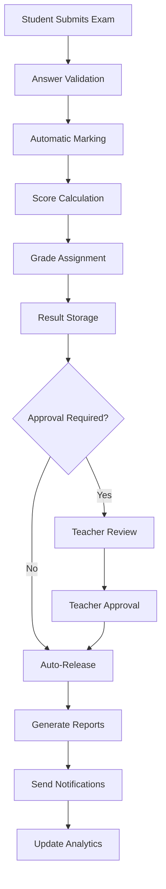

# CBT Platform — Phase 9: Results & Analytics

**Version:** 1.0  
**Date:** October 14, 2026  
**Phase Duration:** 7-10 days  
**Team Size:** 3 developers  
**Risk Level:** Medium  
**Dependencies:** Phase 6 (Exam Engine) + Phase 8 (Sync System) complete  

---

## Table of Contents

1. [Phase Overview](#1-phase-overview)
2. [Phase Story](#2-phase-story)
3. [Implementation Prompt](#3-implementation-prompt)
4. [Independent Verification Prompt](#4-independent-verification-prompt)

---

## 1. Phase Overview

### 1.1 Phase Goals

Phase 9 implements the **results processing and analytics system** that automatically marks exams, calculates grades, generates reports, and provides insights into student performance and question effectiveness.

### 1.2 Key Deliverables

| Deliverable | Description | Success Criteria |
|-------------|-------------|------------------|
| **Automatic Marking Engine** | Process exam submissions into scores | Accurate, fast marking for all question types |
| **Grade Book System** | Organize and display student results | Teachers can view and manage grades |
| **Report Generation** | Student, class, and school performance reports | Comprehensive reporting for all stakeholders |
| **Analytics Dashboard** | Performance insights and trends | Data-driven insights into learning |
| **Result Distribution** | Secure delivery to students and parents | Results reach intended recipients only |
| **Notification System** | Alert stakeholders when results are ready | Timely notifications via email/SMS |

### 1.3 Results Processing Pipeline

### 1.4 Success Criteria

✅ **Automatic marking produces accurate results**  
✅ **Grade books provide clear performance overview**  
✅ **Reports meet all stakeholder information needs**  
✅ **Analytics provide actionable insights**  
✅ **Result distribution respects privacy and permissions**  
✅ **Processing scales to thousands of simultaneous submissions**  

---

## 2. Phase Story

### 2.1 The Results Challenge

The ultimate value of computer-based testing lies not in the delivery mechanism, but in the insights generated from student performance. Phase 9 transforms raw exam data into meaningful information that drives educational decisions and student improvement.

### 2.2 What We're Building

**The Intelligent Marking Engine**  
Sophisticated scoring that goes beyond simple right/wrong answers to provide partial credit, recognize alternative correct responses, and handle complex question types fairly and consistently.

**The Comprehensive Grade Book**  
Modern grade management that organizes results by class, subject, and time period, with flexible views for teachers, administrators, and parents based on their needs and permissions.

**The Insight Generation System**  
Analytics that identify learning patterns, highlight struggling students, reveal question effectiveness, and provide actionable data for curriculum improvement.

**The Secure Distribution Network**  
Privacy-compliant result delivery that ensures students and parents receive only appropriate information while maintaining complete audit trails for compliance.

### 2.3 Why This Phase Matters

**Educational Impact**: Results and analytics transform testing from assessment into learning improvement, providing data-driven insights for teachers and students.

**Time Savings**: Automatic marking eliminates hours of manual grading, allowing teachers to focus on instruction and student support.

**Insight Quality**: Advanced analytics reveal patterns invisible in traditional grading, enabling proactive intervention for struggling students.

**Stakeholder Communication**: Clear, timely results improve communication between schools, students, and parents, building trust and engagement.

### 2.4 Phase Success Story

When Phase 9 is complete:

**For Teachers:**
- Instant access to marked exams and calculated grades
- Rich analytics showing class performance patterns
- Identification of questions that need improvement
- Streamlined result approval and release process
- Data-driven insights for curriculum planning

**For Students:**
- Fast, accurate feedback on exam performance
- Detailed breakdown showing strengths and areas for improvement
- Historical performance tracking and progress visualization
- Secure access to personal results and analytics

**For Parents:**
- Timely notifications when results are available
- Clear, understandable performance reports
- Progress tracking over time
- Appropriate visibility into child's academic performance

**For Administrators:**
- School-wide performance analytics and trends
- Class and teacher comparison data
- Curriculum effectiveness insights
- Compliance reporting for educational authorities